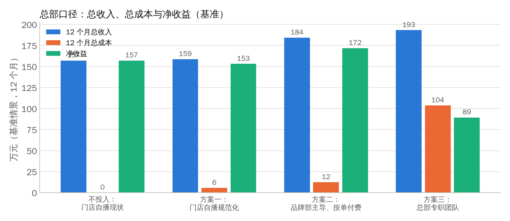
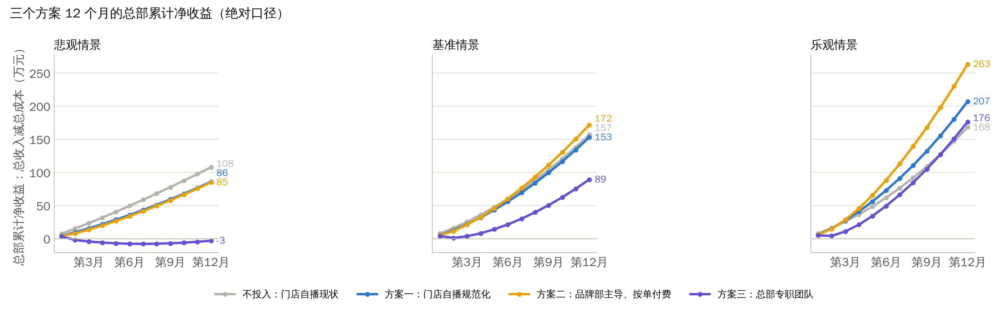

# 住小叮抖音直播：三个方案怎么选

**股东会简版（总收入减总成本口径，12 个月）**　2026 年 11 月

**一句话结论**：现在不投固定人头。用品牌部牵头的“零固定成本”方式把抖音做起来（方案二），同时把品牌部从成本中心变成收入部门；专职团队（方案三）等门店到 60 到 80 家、营销费到位、试点数据达标后再上。

**口径**：总部 12 个月从抖音拿到的总收入（4% 或 8% 分成，加这些订单的 3.5% 管理费）减去总部为此花的全部成本。悲观、基准、乐观三种情景，门店从 30 家增至约 80 家。“不投入”是对照：门店继续自己播，总部什么都不做。详细假设、来源和核验见随附的详版文档与财务模型。

# 1 三个方案放在一起

| 项目 | 不投入（现状延续） | 方案一：门店自播规范化 | 方案二：品牌部主导的总部直播 | 方案三：总部专职直播团队 |
|------------------------------------|------------------------------------|------------------------------------|------------------------------------|------------------------------------|
| 做什么 | 门店前台、店长自己播，总部不管 | 周日至周四可用的平价加权益券；总部管库存、门店只核销；门店参与协议与提成清分；运营部现有人员兼任督导 | 在方案一基础上：品牌部用品牌号常态开播，招 2 到 4 名按核销付佣金的兼职主播或达人（佣金由核销门店出），承接新店开业预售；总部主导订单分成提到 8% | 在方案一基础上：4 人专职团队（运营、主播、中控、投手）加投流，同时承接品牌传播；团队订单分成 8%，门店分担一半投流 |
| 新增正式编制 | 0 | 0 | 0 | 4 人 |
| 一次性投入（万元） | 0 | 2.0 | 3.5 | 6.5 |
| 12 个月总成本（万元，基准） | 0 | 6 | 12 | 104 |
| 12 个月总收入（万元，悲观 / 基准 / 乐观） | 108 / 157 / 168 | 92 / 159 / 213 | 98 / 184 / 275 | 102 / 193 / 299 |
| 其中分成收入（万元，基准） | 84 | 85 | 103 | 109 |
| **12 个月净收益（万元，悲观 / 基准 / 乐观）** | **108 / 157 / 168** | **86 / 153 / 207** | **85 / 172 / 263** | **-3 / 89 / 176** |
| 比不投入多赚（万元，基准） | — | -4 | 15 | -68 |
| 第 12 月抖音分成（万元/月，基准） | 10.0 | 10.2 | 12.3 | 12.9 |
| 第 12 月抖音份额（基准） | 7.2% | 7.3% | 8.0% | 8.2% |
| 门店端 12 个月收益变化（万元，基准） | 302 | 472 | 519 | 528 |
| 品牌传播 | 无统一内容，各店各说各话 | 统一话术与素材包 | 品牌号常态直播、统一内容、新店开业预售，品牌曝光明显增加 | 最强：每天开播的品牌直播间，内容资产沉淀，团队同时承担品牌传播 |
| 品牌部的定位 | 成本中心（约 1.4 万/月） | 成本中心 | **转为收入部门**：考核总部主导订单的核销 GMV 与 8% 分成；可归属收入基准约 22.6 万/年，覆盖自身成本 95%，加 0.5% 营销费后远超 | 并入团队：团队既是销售部门也是品牌部门；成本约 8.9 万/月，要靠 1% 营销费（约 15.0 万/月）或份额大幅提升才养得起 |
| 主要风险 | 旺日关库存被平台处罚；产出随新鲜感衰减 | 门店不签参与协议 | 兼职主播质量参差、流动大；品牌人员本职被挤占；8% 分成谈不下来则增量缩小 | 固定成本；悲观情景净收益为负；主播流失 |
| 什么时候做 | — | 立即，是所有方案的基础 | 立即 | 门店 60 到 80 家、营销费到位、实测每小时售出不低于 4,349 元后 |

# 2 怎么理解这些数

- **4 万从哪来、会变成多少。** 上月 4 万是门店自播产生的 4% 分成。随门店从 30 家增到 80 家，什么都不做，分成也会涨到第 12 月约 10.0 万/月（12 个月合计约 84 万）；加上抖音订单的管理费，总部 12 个月从抖音拿到约 157 万。所以比较方案时要看“比不投入多多少”，不能把本来就有的钱算成某个方案的回报。
- **份额为什么只到 8%。** 模型只计入已安排的产能（品牌号直播时长、兼职主播小时数、新店预售），上表的份额是这些产能的结果，不是上限。份额每提升 1 个百分点，总部每月多得约 4,873 到 12,764 元（30 家店）；要把份额从 7% 做到 15%，30 家店每月要多售出约 186 万元券，相当于成熟期总部直播间约 548 小时/月。份额的天花板在门店（旺日关库存、加盟店抵触折扣券），不在总部播多少。
- **为什么专职团队赚得少。** 总部每个抖音间夜只净得 3 到 7 元（4% 分成）或 7 到 10 元（8% 分成）。团队每月成本约 8.9 万，要每月多卖约 210 万元的券才打平，而基准假设团队成熟期每月卖约 64 万。方案三基准 12 个月净收益 89 万，比不投入少 68 万；乐观情景（每小时卖 6,000 元、核销率 65%）才比不投入多 8 万；悲观情景净收益为负。
- **方案二为什么划算。** 成本几乎都是变动的：主播佣金按核销从门店到账中划转，总部只出试点设备、内容与协调杂费；收入多了总部主导订单的 8% 分成和新店开业预售。基准 12 个月净收益 172 万，比不投入多 15 万，乐观多 95 万，悲观与不投入基本持平（85 万对 108 万）。若总部主导订单的 8% 分成谈不下来、仍按 4%，方案二基准 12 个月净收益 162 万，比不投入多 5 万。
- **方案一为什么值得做，虽然总部不多赚。** 规范化加工作日券让总部比不投入略少（-4 万），因为换成工作日券少卖一些、还要花培训巡检的钱（工作日券的间夜更多是真增量、替代 OTA 订单少，若把少丢的管理费算进来则比不投入略多 6 万，见附）；换来的是门店端多赚约 170 万、拒单处罚风险消除、总部拿回库存权限。它是方案二和方案三的前提。
- **品牌部怎么变成收入部门。** 品牌部现在是成本中心，约 17.0 万/年。方案二把总部主导的抖音销售（品牌号直播间、兼职主播管理、新店预售）交给品牌部并按核销 GMV 与分成考核，可归属收入基准约 22.6 万/年，已接近覆盖自身成本；再加上行业惯例的 0.5% 品牌营销费（30 家店约 7.5 万/月），品牌部就是净贡献部门。方案三的品牌传播更强，但要先养 4 个人。
- **1% 营销费怎么用。** 按 1% 计约 15.0 万/月（80 家店约 40.0 万/月），足以覆盖方案三的全部成本。但它改变的是“谁出钱”，不改变团队多卖出来的价值，而且是门店（含代运营店的投资人）到总部的转移，要和门店拿到的抖音增量、新店预售一起写进参与协议。建议 0.5% 起步、与方案二同步，1% 与方案三的启动绑定。

# 3 建议与路线

1. **立即做方案一加方案二**，品牌部牵头总部直播、运营部牵头门店与渠道、数字化负责清分与数据；总部新增现金控制在 3.5 万以内，不投固定人头。
2. **把三条机制写进门店参与协议**：总部主导订单分成 8%、主播佣金按核销从门店到账划转、0.5% 品牌营销费；品牌部的考核改为核销 GMV、分成收入与新店预售兑现率。
3. **方案三按条件触发，不设时间表**：门店到 60 到 80 家；营销费或 8% 分成的月收入不低于团队成本；试点实测每小时售出不低于 4,349 元；80% 以上门店签约。满足了，团队上线当月就能打平。

# 4 要股东拍板的三件事

1. 接受“总收入减总成本、12 个月、三情景”的口径和上表的数字。
2. 批准方案一加方案二立即启动，品牌部转为收入部门。
3. 批准 0.5% 营销费与 8% 分成写入参与协议；方案三按第 3 节的条件触发。

# 附：口径与关键假设

- 校准：上月 4 万为纯 4%、按核销的分成，对应核销 GMV 约 100 万/月；按 1% 营销费约 15 万/月，系统月流水约 1,500 万、月间夜约 15 万（相当于每店约 196 间房的产出，需用实际房量核对）；抖音份额约 7.4%。
- 情景：核销率悲观 45%、基准 55%、乐观 65%；门店 30 家增至约 80 家，新店首月按半店计；专职团队成熟期每小时售出 2,500 / 4,000 / 6,000 元，兼职主播 2,000 / 3,000 / 4,000 元；平日核销中约一半是真增量（基准）；券价九折 90 元，改工作日券后销量按 85% 计；新店开业预售每店 150 / 300 / 500 张。
- 成本：方案一为培训 2 万一次性加 0.3 万/月；方案二另加试点设备 1.5 万、内容与协调约 0.5 万/月，主播佣金 12% 由门店出；方案三为 4 人团队含社保约 6.1 万/月加备播、场地、投流 3 万/月（门店分担一半）、设备 3.5 万、招聘 1 万；现有品牌营销人员薪酬 1 万/月与现有人员的时间（运营部兼任督导、品牌人员开播）不计价，这是方案一、二“零固定成本”的前提。
- 收入：分成 4%（总部主导订单 8%）按核销结算，加抖音订单 3.5% 的管理费；不含营销费（营销费单独测算）。未扣除抖音订单替代 OTA 订单而少收的管理费；若扣除（详版口径），方案一、二、三比不投入多赚分别为 6 / 21 / -64 万。
- 门店端：指门店业主（加盟商或代运营店投资人）的损益变化，总部不享有。
