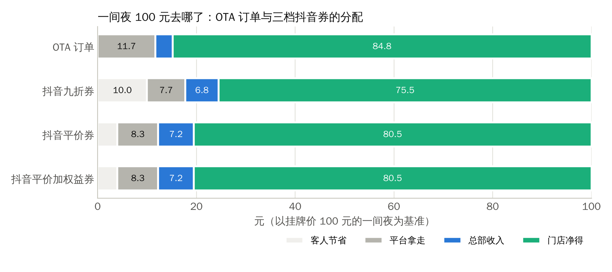
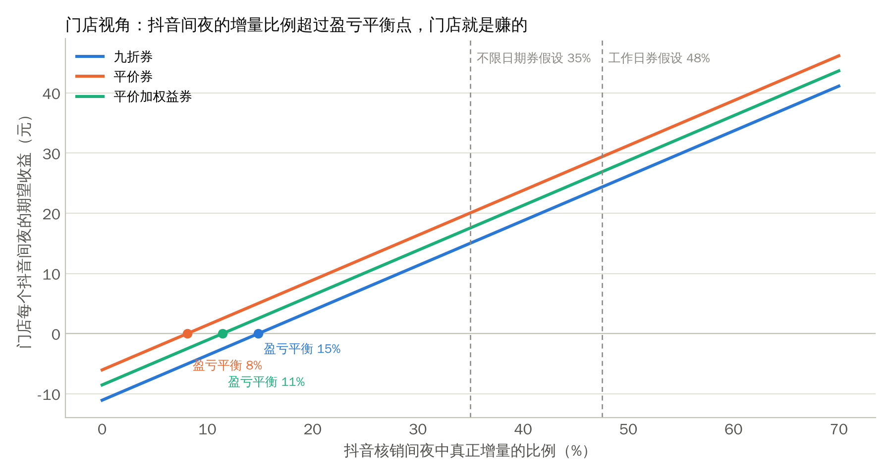
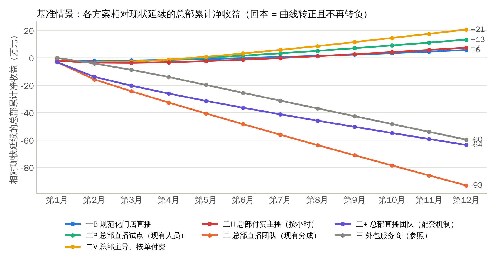
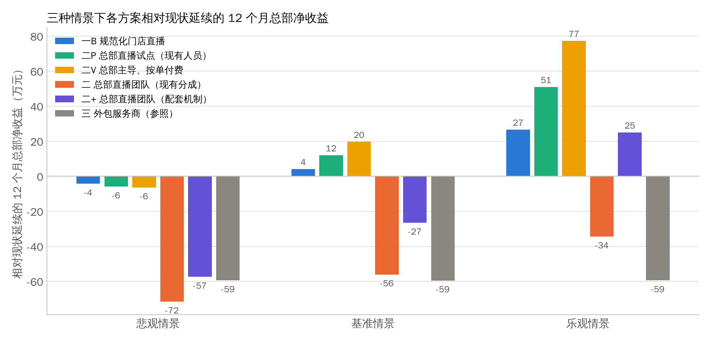
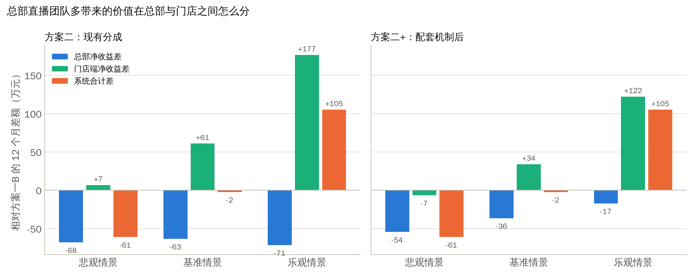
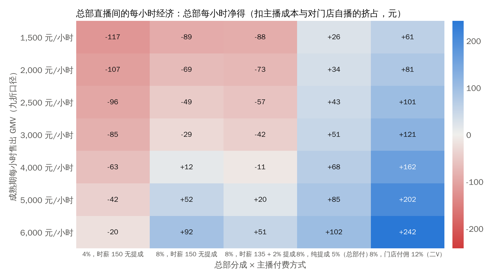

# 住小叮抖音直播：组织方案、定价机制与牵头部门

**股东决策文档**　2026 年 11 月

**文档性质**：供股东会决策使用。正文约 25 分钟可读完；第一章是一页摘要，后面各章是支撑材料。配套文件：《住小叮抖音直播财务模型.xlsx》（参数可调）、研究笔记目录（来源逐条可查）。

**数据口径**：公司事实来自决策人提供的数据（2026 年 10 月）；外部数据来自公开来源，附录 C 逐条列出；凡标注"假设"的参数，均在模型假设表中可改，改后全部结果自动重算。金额单位为人民币元，"万"指万元。

# 一、决策摘要

## 1.1 要股东拍板的三件事

| 决策 | 备选项 | 本文建议 |
|----------------------|------------------------------------|------------------------------------|
| 抖音直播由谁来做 | 门店店长或前台分散直播；总部组建集中直播团队；外包服务商 | **分两步走**：先用三个月把门店直播规范化（方案一B），同时用现有品牌号做总部直播间试点；满足关卡条件后再组建集中团队，并且必须配套新的分成机制（方案二+） |
| 通兑券怎么定价、怎么卖 | 九折；平价（对标 OTA 展示价）；平价加权益 | **主力产品改为"周日至周四可用的平价加权益券"**，九折只作为限时促销工具；周五周六单独设券或不售 |
| 由哪个部门牵头 | 运营部；品牌部 | **运营部牵头渠道，品牌部负责内容、投放与品牌号**；分工表见第八章 |

## 1.2 五个核心结论

1. **抖音已经是一个真实的渠道，不是试水。** 上月总部分成 4 万元，倒推核销流水约 100 万元、售出约 167 万元，核销间夜约占全系统间夜的 14.5%。这些成绩是门店子账号、前台或店长出镜、没有培训和投流的情况下做出来的。
2. **利益分配比"谁来播"更根本。** 一个本来会在 OTA 成交的间夜换到九折抖音券，门店少赚约 10.5 元，总部多赚约 3.2 元。门店在周末满房时关库存，是理性行为，不是态度问题。机制必须让平日和旺日分开处理，而不是靠行政命令。
3. **平日的抖音单对门店是赚钱的，前提是有足够的真增量。** 按模型，只要抖音核销间夜中超过 14%（九折）或 7%（平价）是真正填补空房的新客，门店就是净赚的。改为工作日券后，门店每个抖音间夜的期望收益从 16.4 元升到 26.0 元（九折口径）。
4. **集中团队创造的价值主要落在门店，总部按现有分成拿不到。** 基准情景下，集中团队比规范化的门店直播多创造系统净收益 51.8 万元（12 个月），其中门店多得 89.2 万元，总部反而少 37.4 万元。配套"谁投入谁分成"的机制后，总部只少 7.1 万元，接近打平。乐观情景下团队的价值很大（系统多 279.2 万元），悲观情景下系统反而少 28.7 万元。这是一个押注规模和执行力的决定，适合分阶段、设关卡。
5. **平台规则已经替我们做了一半的机制设计。** 抖音 2026 年起明确禁止酒店"临时关闭库存、无正当理由拒单"，到店无房要退一赔一甚至赔三；同时团购商品必须有划线价且团购价低于划线价。这意味着"门店自己关库存"是合规风险，"不限日期的深折扣券"也不是长久之计；合规的做法是在商品层面设定不可用日期和可预约库存。另一方面，2026 年 7 月携程因强制"全网最低价"被罚没 51.79 亿元并取消该条款，九折券对 OTA 的价格冲突风险明显下降。

## 1.3 建议的路径与投入

| 阶段 | 时间 | 做什么 | 总部投入（基准） | 预期结果（基准） |
|------------------------------------|------------|------------------------------------|------------------------------------|------------------------------------|
| 第一阶段：规范化门店直播 + 产品与机制改造 | 第 1 到 3 月 | 工作日券、平价加权益、划线价合规；来客账号权限收紧为"总部管商品、门店只核销"；门店参与协议与提成清分；1 名直播督导；培训与 SOP；品牌号总部直播试点 | 一次性约 4.4 万，每月约 2.1 万 | 12 个月总部净收益 106.5 万，门店端 641 万；拿到总部直播间的真实产出数据 |
| 决策关卡 | 第 4 月 | 按第九章的六项指标评估是否组建集中团队 | — | — |
| 第二阶段：集中直播团队（方案二+） | 第 4 月起 | 4 人团队、设备、投流；团队直播间订单总部分成提至 8%，门店分担一半投流；团队同时承接品牌传播工作 | 每月净增约 4.5 万（扣除可抵减的品牌预算后） | 12 个月总部净收益 99.4 万，系统合计 800 万；乐观情景总部 207.8 万 |

## 1.4 最大的三个风险

- **核销率低于估计。** 行业酒旅团购核销率不足 50%，公司自估 60%。核销率每低 10 个百分点，总部收入同比例下降；模型悲观情景按 45% 计算。
- **替代率高于估计。** 如果抖音买家大多数本来就会在 OTA 订本品牌，门店就是在用更低的价格卖同样的房。模型基准按 55% 的买家"本来就会订"计算，这是最需要用真实数据验证的假设，第一阶段要建立度量。
- **履约违规。** 门店拒绝核销或变相拒绝（说没房），平台会处罚到商品和门店，2026 年起赔付标准提高。机制上必须把"关库存"的权限从门店收回到总部，并把不可用日期写进商品。

# 二、现状与上月复盘

## 2.1 基础数据

| 项目 | 数值 | 说明 |
|----------|------------------------------------|------------------------------------|
| 门店 | 北京 30 家，20 家总部代运营，10 家加盟商自管 | 店长多为总部员工，薪酬约 1 万元/月，记在门店损益 |
| 单店 | 约 100 间房，平均房价约 100 元/晚，入住率 85% 以上 | 很多门店 90% 以上，周末基本满房 |
| 系统月流水 | 约 765 万元 | 挂牌价口径 |
| 总部管理费 | 流水的 3.5%，约 24.1 万元/月 | 模型按门店到账金额计提；抖音订单同样计提 |
| OTA 结构 | 携程、美团佣金约 8%，另有 4% 由平台控价 | 客人看到的价格在 96 到 100 元之间，酒店按 96% 收款再扣 8% 佣金 |
| 抖音 | 通兑券约九折，90 天有效，过期自动退 | 抖音抽 8%，总部抽 4%，门店到账 88%；门店可自设库存 |
| 组织 | 运营部 6 人（总监、副总监、质检、三个片区负责人） | 副总监管 OTA 与抖音运营；销售总账号与门店子账号归运营；品牌抖音号归品牌部，粉丝不到 1 万，1 人，月预算 2 万 |
| 扩张 | 未来 12 个月北京新增约 40 家，上海、深圳约 10 家 | 模型按月均新增约 4.2 家 |

## 2.2 上月 4 万元的复盘

上月总部从抖音拿到 4 万元分成，口径是纯 4%、按核销结算、没有投流。倒推如下：

| 指标 | 数值 | 推算方式 |
|----------------|-------------------------|------------------------------------|
| 核销 GMV | 约 100 万元 | 4 万 ÷ 4% |
| 售出 GMV | 约 167 万元 | 按 60% 核销率倒推；其余过期自动退 |
| 售出券数 | 约 18,519 张 | 按 90 元/张 |
| 核销间夜 | 约 11,111 间夜 | 约占全系统月间夜 14.5%，平均每店每月 370 间夜 |
| 总部实际增量收入 | 约 4.8 万元/月 | 4 万分成 + 抖音订单的管理费约 3.1 万 − 被替代的 OTA 订单原本的管理费约 2.3 万（按不限日期券的替代率假设推算） |
| 门店端净收益变化 | 约 18.3 万元/月（全系统） | 增量间夜的贡献减去替代间夜的损失，不含门店直播的时间成本；按不限日期券的增量比例 35.0% 推算 |

这笔成绩的三个含义：

- **需求是真实的，价格是对的。** 没有培训、没有投流、没有机制，一个月做到全系统流水的 13% 左右，说明这个客群在抖音上有购买习惯，九折价位有吸引力。
- **它已经大到不能不管。** 抖音间夜占比接近 15%，意味着替代效应已经实质影响门店收入结构。今天的问题不是"要不要做"，而是"怎么让它对门店也划算"。
- **我们对它几乎没有度量。** 目前没有场次、观看、转化、核销率、拒单率的系统数据。行业经验是门店矩阵的产出高度集中（蜜雪冰城 5000 多个门店账号中，交易额过百万的只有 20 多个），住小叮大概率也是少数几家店贡献了大部分流水。第一阶段必须先把数据建起来。

## 2.3 现在的问题

| 问题 | 根源 | 本文对应的解法 |
|----------------------------------|------------------------------------|------------------------------------|
| 门店在旺日关抖音库存，客人兑换不了 | 周末满房，抖音券替代的是全价订单；平台现在把"临时关闭库存"列为违规 | 商品层面设不可用日期（工作日券），总部收回库存权限，参与协议写明库存承诺（第七章） |
| 加盟店抵触低于售价的券 | 替代间夜每夜少赚约 10.5 元；而总部每单多赚 | 定价改为平价加权益；用单店损益表把账算给门店看；提成由核销门店划转给开播门店（第六、七章） |
| 账号与职责分散 | 品牌号在品牌部，销售总号与门店子账号在运营部，OTA 运营组职责里也写了自媒体运营 | 明确渠道牵头部门与分工（第八章） |
| 店长没有动力播 | 考核本店营收，但券是全系统通兑、按核销门店归属 | 开播门店提成与跨店归因（第七章） |

# 三、市场与同业

## 3.1 抖音酒旅的规模与走向

| 指标 | 数据 | 来源 |
|--------------------------|------------------------------------|------------------------------------|
| 抖音生活服务整体 | 2025 年支付 GMV 超 8500 亿元，同比 +59%；2026 年目标增速约 50% | 媒体口径（雷峰网、虎嗅、晚点），附录 C-1 |
| 酒旅订单增速 | 2025 年酒旅团购订单 +42%，酒店民宿订单 +63%；2026 年春节酒店团购订单 +94%，中秋国庆酒店宾馆订单 +79% | 抖音官方文旅数据报告，附录 C-2 |
| 抖音在在线酒店预订中的份额 | 2024 年约 3%（GMV 口径）；携程系约 70%，美团 13% 到 20% | 交银国际等估算，附录 C-3 |
| 直播的作用 | 2026 年官方口径：32% 的用户通过直播间下单酒店 | 抖音《2026 文旅消费趋势报告》，附录 C-4 |
| 复购 | 超过 60% 的酒旅订单用户在 30 或 90 天内复购，平均复购周期 19 天 | 同上 |
| 核销率 | 行业酒旅团购核销率不足 50%；国信证券估算约 30%（含达人与度假囤券）；主动搜索型购买 68% 到 75% | 虎嗅 2026-03、国信证券 2025-07、21 财经，附录 C-5 |
| 日历房 | 订单占比不到 15%（2025 年中）；平台持续推动从囤券向可定日期的日历房迁移 | 国信证券估算，附录 C-5 |

对住小叮的含义：这个渠道还在高速增长，但平台整体核销率低，经济型、刚需、自播为主的模式核销表现会好于平台均值；平台在把流量导向日历房和低价活动，经济型连锁拿到"免费流量"的空间在收窄，自播和搜索型成交是更可靠的路径。

## 3.2 规则变化：三件直接影响方案的事

**费率。** 住宿类目软件服务费自 2024 年 7 月 1 日起由 4.5% 升至 8%，另有 0.6% 支付手续费，2026 年 8 月起经豆包入口成交的订单按约 12% 收取。公司口径的"抖音拿 8%"应对应软件服务费，实际平台侧扣费约 8.6%，财务上要核对这 0.6% 由谁承担（附录 C-6）。

**履约。** 2024 年 12 月起，拒单、到场前推翻、到店无房分别屏蔽货架 3、14、30 天，到店无房"退一赔三"；2026 年五一专项将差价赔付上限提至订单金额 3 倍；2026 年暑期专项明确禁止"临时关闭库存、无正当理由拒单、区别对待"，违规可警告、封禁商品、门店禁售、扣罚保证金；中秋国庆专项对有"到店没房"记录的酒店主动电话核实，确认后退一赔一并直接下架商品（附录 C-7）。门店自行关库存，在规则上已经是品牌级的风险。

**价格展示。** 团购商品必须有划线价，划线价须有依据（门市价、线下价目、指导价），且团购价必须低于划线价，平台不接受没有优惠的商品上架；同时平台持续打击虚构原价和不合理低价（附录 C-8）。"平价券"在形式上可行，前提是门市价高于 100 元且有依据。另一方面，2026 年 7 月 25 日市场监管总局对携程罚没 51.79 亿元，携程公布 19 项整改并取消"全网最低价"要求、下线自动调价工具；2026 年 9 月北京市监局对美团等平台的同类条款立案调查（附录 C-9）。OTA 对抖音低价的约束力明显减弱，但监管同时在压制"价格内卷"，深折扣的空间也在收窄。

## 3.3 同业怎么做

| 企业 | 组织方式 | 公开成绩 | 对加盟店的处理 |
|----------------------|------------------------------------|------------------------------------|------------------------------------|
| 华住（汉庭、全季等） | 集团官号（2025 年双 11 时 171 万粉丝、每日开播）+ 区域矩阵号 + 门店职人号（店长、前台、销售出镜）+ 达人；集团统一管理货品与交易归因 | 2024 年暑期 10 天支付 GMV 超 8000 万元，单场估计超 300 万元 | 通兑券全国通用，集团设计方案下发门店，营销费用集团出，门店只需让价 |
| 首旅如家 | 品牌直播间配合平台大促 | 2025 年 7 月 16 日单日成交 GMV 突破 1000 万元，6000 余家门店参与 | 通兑预售券 7 到 8 折，日历房 85 折 |
| 锦江 | 总部直播验证后，推"AI + 门店员工直播矩阵" | 2025 年双 11 视频号累计成交 138 万元、近 7000 单 | 通兑券 79 到 169 元/晚 |
| 尚美数智（尚客优） | 总部 20 人集中直播团队专攻客房（2022）；区域总部自播 | 区域首场约 2.8 万元 | — |
| 亚朵 | 以品牌自播为主，2023 年 342 场 | 某场双 11 直播 90% 流量来自付费投流 | — |
| 东呈、格林、途客、优程 | 无公开的抖音直播组织信息 | — | — |
| 第三方代运营 | 酒旅专项报价：基础服务费 4 到 5 万元/年加 8% 到 12% 佣金；或月费 6000 元加 10% 佣金；代播 500 到 2000 元/小时 | — | — |

来源见附录 C-10 到 C-13。三个观察：第一，头部集团全部采用"总部号 + 门店号"的双层结构，不是二选一；第二，没有任何一家公开过团队人数、归属部门或抖音占总预订的比例，也没有公开总部与加盟店之间关于抖音订单的分成机制，这部分只能靠我们自己设计；第三，超经济型、青旅、胶囊类品牌在抖音直播的公开成绩几乎为零，住小叮没有现成的对标，上月的 4 万元本身就是这个细分业态里少见的数据点。

# 四、核心账：每间夜的钱去哪了

## 4.1 单位经济

以挂牌价 100 元的一间夜为基准，四种成交方式下各方拿到多少：

| 每间夜（元） | OTA 订单 | 抖音九折券 | 抖音平价券 | 抖音平价加权益券 |
|------------------------------------|--------:|----------:|----------:|----------------:|
| 客人支付（券价或挂牌价） | 100.0 | 90.0 | 96.0 | 96.0 |
| 平台拿走 | 11.68 | 7.20 | 7.68 | 7.68 |
| 总部分成 | 0.00 | 3.60 | 3.84 | 3.84 |
| 门店到账 | 88.32 | 79.20 | 84.48 | 84.48 |
| 总部管理费（到账 × 3.5%） | 3.09 | 2.77 | 2.96 | 2.96 |
| 总部收入合计 | 3.09 | 6.37 | 6.80 | 6.80 |
| 门店净得（到账 − 管理费） | 85.23 | 76.43 | 81.52 | 81.52 |
| 权益成本 | 0.0 | 0.0 | 0.0 | 2.5 |
| 变动成本 | 10.0 | 10.0 | 10.0 | 10.0 |
| 增量一夜的门店贡献（净得 − 权益 − 变动成本） | 75.23 | 66.43 | 71.52 | 69.02 |

说明：OTA 订单的平台拿走 = 4 元控价 + 96 元的 8% 佣金；总部管理费按门店到账的 3.5% 计提；变动成本为假设（清洁、布草、水电、耗材），可在模型中修改。

## 4.2 替代还是增量

抖音券卖出的一个间夜，有两种可能：一是客人本来就会在 OTA 订我们（替代），二是客人本来不会来，或者本来房间空着（增量）。两种情况下门店和总部的得失完全不同：

| 替代一夜（元） | OTA 订单 | 抖音九折券 | 抖音平价券 | 抖音平价加权益券 |
|------------------------------------|--------:|----------:|----------:|----------------:|
| 被替代间夜的门店净得（OTA 与直订加权） | 86.92 | 86.92 | 86.92 | 86.92 |
| 被替代间夜的总部收入（加权） | 3.15 | 3.15 | 3.15 | 3.15 |
| 替代一夜：门店损失 | 0.00 | 10.49 | 5.40 | 7.90 |
| 替代一夜：总部变化 | 0.00 | 3.22 | 3.64 | 3.64 |
| 替代一夜：客人节省 | 0.0 | 10.0 | 4.0 | 4.0 |
| 门店盈亏平衡所需增量比例 | 0% | 14% | 7% | 10% |

从这张表可以直接读出利益错位：**九折券每替代一个间夜，门店少赚 10.5 元，总部多赚 3.2 元，客人省 10 元，平台少拿 4.5 元。** 门店是唯一的输家。而每一个增量间夜，门店多赚 66.4 元。

因此门店是否划算，取决于抖音间夜里真增量的比例。模型把这个比例拆成两个因素：核销落在满房日的比例（满房日的抖音间夜一定是替代），以及抖音买家中"本来就会订本品牌"的比例。

| 项目 | 九折券 | 平价券 | 平价加权益券 |
|------------------------------------|------:|------:|------------:|
| 增量比例：不限日期券 | 35.0% | 35.0% | 35.0% |
| 增量比例：工作日券 | 47.5% | 47.5% | 47.5% |
| 门店每抖音间夜期望收益：不限日期券 | 16.43 | 21.53 | 19.03 |
| 门店每抖音间夜期望收益：工作日券 | 26.05 | 31.14 | 28.64 |
| 总部每抖音间夜期望增量收入：不限日期券 | 4.32 | 4.75 | 4.75 |
| 总部每抖音间夜期望增量收入：工作日券 | 4.72 | 5.14 | 5.14 |

两个关键判断：

- **门店的盈亏平衡点很低。** 只要超过 14%（九折）、7%（平价）、10%（平价加权益）的抖音间夜是真增量，门店就是赚的。85% 的入住率意味着平日每晚约有 15 间空房，平日的抖音单大概率是在填空房。
- **周末是另一回事。** 周末满房时，每一个抖音间夜都在替代全价订单，门店关库存是对的。所以机制的核心不是"禁止关库存"，而是"把周末从券里拿掉"。工作日券把增量比例从 35.0% 提到 47.5%（模型假设），门店每个抖音间夜的期望收益从 16.4 元升到 26.0 元。

这些比例目前都是假设。行业可参照的数据是度假与高星酒店直播核销客人中新客占 71% 到 80%（洲际 2026、Club Med 2025），经济型连锁没有公开数据，也没有任何研究量化过"抖音订单替代了多少 OTA 订单"。模型按更保守的"平日核销中一半是真增量"（基准，区间 40% 到 70%）计算，叠加满房日因素后，不限日期券的真增量比例为 35.0%，工作日券为 47.5%。第一阶段的首要任务之一就是用订单匹配、问卷和门店对照测出住小叮自己的数字。

# 五、三个组织方案的对比

## 5.1 方案定义

| 方案 | 定义 | 总部投入 |
|---------------------------|------------------------------------|------------------------------------|
| 一A 门店自播，现状延续 | 各店子账号自播，前台或店长出镜，无培训、无激励、无投流（即上月的做法） | 0 |
| 一B 规范化门店直播 | 在一A 基础上：1 名直播督导、培训与 SOP、每店设备补贴、每周开播 KPI、开播门店提成（由核销门店到账划转，总部清分）、产品与库存机制改造 | 一次性约 4.4 万，每月约 2.1 万 |
| 二 总部直播团队（现有分成） | 在一B 基础上：4 人团队（运营负责人、主播、中控兼剪辑、投手兼内容）、设备、场地、投流；团队同时承接品牌传播工作，抵减现有品牌预算与人员；分成仍为抖音 8%、总部 4%、门店 88% | 团队含社保约 5.8 万/月，投流 3 万/月，抵减品牌预算 3.4 万/月 |
| 二+ 总部直播团队 + 配套机制 | 同方案二，另加两条机制：团队直播间和投流带来的订单，总部分成提至 8%（门店到账 84%）；投流预算由门店分担一半 | 同上 |
| 三 外包服务商（参照） | 门店自播维持现状，另请服务商代播：月固定费 0.8 万、售出 GMV 的 10% 佣金、投流 2 万/月 | 约 4 到 5 万/月 |

方案三只作参照：服务商按售出 GMV 收 8% 到 12% 的佣金，而总部按核销只拿 4%，总部独自承担服务商费用在结构上不成立，除非门店分担。

## 5.2 定性对比

| 维度 | 一A 现状延续 | 一B 规范化门店直播 | 二 / 二+ 总部团队 | 三 外包 |
|------------|------------------------------------|------------------------------------|------------------------------------|------------------------------------|
| 成本 | 总部零成本；门店付出店长时间 | 总部每月约 2 万，一次性约 4 万 | 总部每月净增约 6 万（扣抵减后），一次性约 4.5 万 | 每月 4 到 5 万，无沉淀 |
| 收益 | 产出随新鲜感衰减，行业经验是门店矩阵的产出集中在少数门店 | 产出提升 15% 到 50%（假设），衰减得到控制 | 增加一个稳定产出的直播间，可投流放大；新城市开店前就能预售 | 产出取决于服务商，合同期短 |
| 风险 | 质量参差、违规连坐、员工离职带走账号、拒单投诉 | 同左但可控；督导离职风险 | 主播年流失率高（行业 60% 到 100%）；团队产出不达预期；总部固定成本 | 服务商为冲 GMV 压价、核销率低；账号与客户资产在服务商手里 |
| 可管理性 | 弱，没有数据 | 中，有 KPI、巡检、清分 | 强，集中可控，话术与价格统一 | 中，靠合同 |
| 可扩展性 | 随门店数线性增长，但新店冷启动慢 | 同左，新店有培训包 | 固定成本摊薄，80 家店时单位成本减半；可覆盖上海、深圳的开业预售 | 可随时放大或停止 |
| 对组织的影响 | 无 | 运营部多一个岗位 | 新设团队；品牌传播职能并入；需要跨部门接口 | 无内部能力沉淀 |
| 品牌与内容 | 门店各自表达，难统一 | 统一话术与素材包 | 统一的品牌声音，内容资产沉淀 | 外部团队难懂品牌 |

## 5.3 财务结果

模型按 12 个月、三种情景计算，门店数从 30 家增至 80 家。总部口径是"增量净收益"：抖音分成、抖音订单的管理费、减去被替代订单原有的管理费、再减去总部成本。系统口径是总部加门店。

| 方案 | 总部净收益 悲观（万） | 总部净收益 基准（万） | 总部净收益 乐观（万） | 系统合计 悲观（万） | 系统合计 基准（万） | 系统合计 乐观（万） |
|-----------------------|---------------------:|---------------------:|---------------------:|-------------------:|-------------------:|-------------------:|
| 一A 现状延续 | 43.2 | 95.9 | 141.3 | 89 | 565 | 1,162 |
| 一B 规范化门店直播 | 28.6 | 106.5 | 189.5 | 76 | 748 | 1,736 |
| 二 总部团队（现有分成） | -11.7 | 69.1 | 149.1 | 47 | 800 | 2,015 |
| 二+ 总部团队 + 机制 | 3.1 | 99.4 | 207.8 | 47 | 800 | 2,015 |
| 三 外包（参照） | -17.1 | 41.2 | 92.3 | 39 | 565 | 1,258 |

基准情景的明细：

| 方案 | 核销 GMV（万） | 总部增量收入（万） | 总部成本（万） | 总部净收益（万） | 回本 | 门店端变化（万） | 系统合计（万） |
|-----------------------|--------------:|------------------:|--------------:|----------------:|-------:|----------------:|--------------:|
| 一A 现状延续 | 1,830 | 95.9 | 0.0 | 95.9 | 第 1 月 | 469 | 565 |
| 一B 规范化门店直播 | 2,668 | 139.8 | 33.3 | 106.5 | 第 2 月 | 641 | 748 |
| 二 总部团队（现有分成） | 2,971 | 155.7 | 86.6 | 69.1 | 第 3 月 | 730 | 800 |
| 二+ 总部团队 + 机制 | 2,971 | 169.5 | 70.1 | 99.4 | 第 2 月 | 700 | 800 |
| 三 外包（参照） | 2,019 | 105.8 | 64.6 | 41.2 | 第 1 月 | 524 | 565 |

悲观与乐观情景的明细见附录 B。三点解读：

- **一B 是没有悬念的改进。** 总部每月约 2 万的投入，换来总部净收益比现状高 10.6 万、门店端高 172 万（基准）。即使在悲观情景下总部也是正的（28.6 万）。
- **方案二在现有分成下，对总部是亏的。** 基准情景总部净收益 69.1 万，比一B 少 37.4 万；悲观情景为 -11.7 万。原因很简单：总部每卖出 1 元券，核销后只拿到约 3.1 分的增量收入，一个 4 人团队加投流每月要卖出几百万元才能打平。
- **方案二+ 把账拉回来了，但仍是押注规模。** 配套机制后基准情景总部 99.4 万，比一B 只少 7.1 万；乐观情景 207.8 万，明显高于一B 的 189.5 万；悲观情景 3.1 万。

## 5.4 集中团队的价值归谁

方案二相对一B（现有分成）：

| 情景 | 多售出 GMV（万） | 多核销 GMV（万） | 总部多增收入（万） | 总部多成本（万） | 总部净收益差（万） | 门店端差（万） | 系统合计差（万） |
|------|----------------:|----------------:|------------------:|----------------:|------------------:|--------------:|----------------:|
| 悲观 | 223.1 | 93.1 | 4.2 | 44.6 | -40.3 | 11.7 | -28.7 |
| 基准 | 543.1 | 303.4 | 15.9 | 53.3 | -37.4 | 89.2 | 51.8 |
| 乐观 | 1,115.1 | 728.1 | 42.1 | 82.5 | -40.4 | 319.5 | 279.2 |

方案二+ 相对一B（配套机制）：

| 情景 | 多售出 GMV（万） | 多核销 GMV（万） | 总部多增收入（万） | 总部多成本（万） | 总部净收益差（万） | 门店端差（万） | 系统合计差（万） |
|------|----------------:|----------------:|------------------:|----------------:|------------------:|--------------:|----------------:|
| 悲观 | 223.1 | 93.1 | 9.0 | 34.6 | -25.6 | -3.1 | -28.7 |
| 基准 | 543.1 | 303.4 | 29.7 | 36.8 | -7.1 | 59.0 | 51.8 |
| 乐观 | 1,115.1 | 728.1 | 73.4 | 55.0 | 18.4 | 260.8 | 279.2 |

这组数据回答了股东最该问的问题：**集中团队到底值不值？** 答案是分两层。对系统（总部加门店），基准情景多赚 51.8 万，乐观情景多赚 279.2 万，悲观情景少 28.7 万。对总部，在现有分成下三种情景都是亏的；配套机制后基准情景接近打平、乐观情景转正。所以集中团队是一个"系统划算、总部不一定划算"的投资，必须和分成机制捆绑决策。

## 5.5 敏感性

方案二相对一B 的稳态每月边际净收益（总部口径，基准参数），对团队直播间产出和投流效率的敏感性：

| 每小时 GMV / ROI | ROI 2 | ROI 3 | ROI 4 | ROI 5 | ROI 6 | ROI 8 |
|----------------|------:|------:|------:|------:|------:|------:|
| 2,000 | -3.6 | -3.6 | -3.5 | -3.5 | -3.4 | -3.3 |
| 3,000 | -3.4 | -3.3 | -3.3 | -3.2 | -3.2 | -3.1 |
| 4,000 | -3.2 | -3.1 | -3.1 | -3.0 | -2.9 | -2.8 |
| 5,000 | -2.9 | -2.9 | -2.8 | -2.8 | -2.7 | -2.6 |
| 6,000 | -2.7 | -2.6 | -2.6 | -2.5 | -2.5 | -2.4 |
| 8,000 | -2.2 | -2.2 | -2.1 | -2.1 | -2.0 | -1.9 |
| 10,000 | -1.8 | -1.7 | -1.7 | -1.6 | -1.5 | -1.4 |

对团队人力成本的敏感性：

| 每小时 GMV / 人力成本 | 人力 4 万/月 | 人力 5 万/月 | 人力 6 万/月 | 人力 7 万/月 | 人力 8 万/月 |
|---------------------|------------:|------------:|------------:|------------:|------------:|
| 2,000 | -1.6 | -2.6 | -3.6 | -4.6 | -5.6 |
| 3,000 | -1.4 | -2.4 | -3.4 | -4.4 | -5.4 |
| 4,000 | -1.2 | -2.2 | -3.2 | -4.2 | -5.2 |
| 5,000 | -0.9 | -1.9 | -2.9 | -3.9 | -4.9 |
| 6,000 | -0.7 | -1.7 | -2.7 | -3.7 | -4.7 |
| 8,000 | -0.2 | -1.2 | -2.2 | -3.2 | -4.2 |
| 10,000 | 0.2 | -0.8 | -1.8 | -2.8 | -3.8 |

读法：在现有分成（总部 4%）下，无论直播间每小时卖多少、投流 ROI 多高，总部口径的边际都是负的，因为总部只拿到每元核销 GMV 约 3.1 分。这不是团队能力问题，是分成结构问题。它同时说明：**总部独自出钱投流在任何情况下都不划算**（保本 ROI 约 25），投流必须由受益的门店分担，或者在团队订单上提高总部分成。

## 5.6 判断

1. 第一阶段做一B 和产品机制改造，是无论如何都应该做的。
2. 集中团队有价值，但它的价值归门店、成本归总部。要做，必须同时改分成，并且在产出数据验证后再上。
3. 把现有品牌号当作总部直播间的试点，由现有品牌营销人员每周播两到三场，三个月内就能测出"每小时卖多少"这个最关键的参数，成本几乎为零。

# 六、通兑券定价：九折、平价、平价加权益

三档定价在同一套门店直播产出下的稳态比较（基准情景，当前 30 家店）：

| 项目（稳态月度，30 家店，门店自播产出） | 九折券 | 平价券 | 平价加权益券 |
|------------------------------------|---------------------------:|---------------------:|--------------------------------:|
| 券价 | 90 | 96 | 96 |
| 销量系数 | 1.00 | 0.85 | 0.95 |
| 月售出券数（全系统） | 18,519 | 15,741 | 17,593 |
| 月售出 GMV（万元） | 167 | 151 | 169 |
| 月核销间夜 | 11,111 | 9,444 | 10,556 |
| 月核销 GMV（万元） | 100 | 91 | 101 |
| 增量比例 | 48% | 48% | 48% |
| 总部月增量收入（万元） | 5.2 | 4.9 | 5.4 |
| 门店端月净收益变化（全系统，不含直播时间成本）（万元） | 28.9 | 29.4 | 30.2 |
| 系统合计（万元） | 34.2 | 34.3 | 35.7 |
| 单店月净收益变化 | 9,646 | 9,803 | 10,077 |
| 客人相对 OTA 挂牌价的节省（每夜） | 10 | 4 | 4 |
| **定性因素** |  |  |  |
| OTA 最低价规则风险 | 高：券价明显低于 OTA 展示价 | 低：与 OTA 展示价持平 | 低：价格持平，权益不构成价格违规 |
| 加盟店接受度 | 低：替代间夜每夜少赚约 9 元 | 高：替代间夜基本无损 | 中高：权益有少量成本 |
| 直播间转化难度 | 低：有明显折扣锚点 | 高：没有折扣理由 | 中：用权益和灵活兑换做卖点 |
| 对周末满房的影响 | 需配合工作日券或不可用日期 | 影响小 | 影响小 |

模型对销量系数的假设：平价券销量为九折的 85%，平价加权益为 95%。依据是对团购券折扣弹性的研究：对 19,978 个 Groupon 团购的分析发现折扣每加深 1%，销量反而下降 0.035% 到 0.256%，商家评分和信任比折扣深度更能带动销量；国内酒店在线销量研究也认为折扣超过 10% 后销量不再随折扣加深而上升（附录 C-14）。直播间的冲动购买属性会放大折扣的作用，所以模型仍对平价券打了折减，这个参数置信度低，需要用 A/B 测试验证。

三个结论：

- **三档对门店和总部的月收益差距不大，但风险和接受度差距很大。** 平价加权益的系统合计最高，门店接受度高，OTA 价格冲突和平台"不合理低价"的风险最低。
- **"平价"不等于不能上架。** 平台要求团购价低于划线价，所以平价券的划线价要用门市价（建议 118 到 128 元，需有前台价目依据），团购价 96 元。这反而把"门市价"这个锚点用起来了。
- **九折留作工具。** 新店开业、淡季、上海深圳进入市场时用限时九折做冷启动，常态用平价加权益。

建议的产品结构：

| 产品 | 适用日期 | 价格 | 权益 | 用途 |
|----------------------|----------------------------------|----------|------------------------------------|------------------------------------|
| 工作日通兑券（主力） | 周日至周四入住，法定节假日除外 | 96 元 | 延迟退房至 14 点（非满房日）、行李寄存、饮用水 | 常态销售，所有参与门店 |
| 周末券 | 周五、周六 | 100 元 | 同上 | 可选；满房门店可不参与 |
| 城市券 | 北京通兑；上海、深圳开业后分城设券 | 按城市定 | 同上 | 避免跨城市库存承诺 |
| 限时促销券 | 指定周期 | 九折或更低 | — | 新店开业、淡季、大促 |
| 日历房（第二阶段评估） | 指定日期直接下单 | 按日价 | — | 平台推动方向，彻底消除"无法兑换"问题，需要房态直连 |

# 七、机制设计：解决关库存与加盟店抵触

## 7.1 产品规则

- 工作日券作为主力，不可用日期在商品层面设定（每周五、六不可用，法定节假日不可用），不依赖门店临时操作。
- 周末、节假日的加价或不可用，必须写入商品详情；2026 年起直播中也必须清晰展示价格和特殊日期信息，到店临时加价属违规。
- 有效期维持 90 天，过期自动退；券的面值和权益全系统统一。

## 7.2 库存与账号权限

- 抖音来客账号体系改为"总部统一管理商品、门店只做核销和订单处理"：总部账号建券、设库存、设不可用日期；门店子账号权限收缩为核销与订单管理，取消门店自行下架或关闭库存的权限。研究显示来客支持按岗位配置子账号权限，但"总部锁定门店库存"的官方权限矩阵未找到，第一阶段要和平台客户经理确认实现方式。
- 参与门店承诺每个工作日的最低可预约库存，建议按该店平日平均空房的一半设定（例如 8 间），由总部按日巡检预约接单情况。
- 拒单零容忍：无正当理由拒单或到店无房，按平台处罚金额全额由门店承担，并取消该店下一个月的开播提成；连续两次暂停该店参与。

## 7.3 分配规则

- 核销门店到账 88% 不变。
- 开播门店或员工提成：按开播场次售出 GMV 的 1.5%（约合核销 GMV 的 2.5%），由核销门店的到账中划转，总部按月清分。跨店核销时，开播门店拿的就是这笔跨店奖励，解决"我播别人核销"的问题。行业参照是员工直播提成按核销计 2% 到 5%、跨店来源奖励 1% 到 3%。
- 集中团队（如组建）直播间和投流带来的订单：总部分成 8%、门店到账 84%，门店在这些订单上的净得仍高于九折券的现状（84% × 96 元 = 80.6 元，高于 79.2 元）。
- 投流基金：如组建团队，投流预算由总部和门店各担一半，门店按抖音到账比例分摊。
- 以上机制对代运营店和加盟自管店一视同仁，差别只在执行力度。

## 7.4 合同与沟通

- 现有加盟合同没有参与总部渠道和保障库存的条款。建议用《抖音渠道参与协议》作为补充协议，内容包括：参与范围、库存承诺、不可用日期、分成与提成清分、违规处理、退出机制（提前 30 天书面通知）。对加盟自管店自愿签署，不签的不纳入通兑券适用门店。
- 用单店损益表和门店谈：按模型，一家典型门店改为工作日平价加权益券后，每月净收益变化约为 9,168 元（已扣除店长的直播时间成本），九折不限日期券约为 5,176 元。

| 单店每月净收益变化（元） | 九折券 | 平价券 | 平价加权益券 |
|------------------------|------:|------:|------------:|
| 不限日期券 | 5,176 | 5,867 | 5,785 |
| 工作日券（周日至周四） | 8,737 | 8,894 | 9,168 |

## 7.4 补充：法律边界（一般性理解，需法务复核）

- **总部约束门店。** 商业特许经营管理条例允许特许人要求被特许人执行统一的经营模式与服务标准，参与总部渠道、保障库存、执行统一券价可以作为经营标准写入补充协议；但对门店自身销售的客房价格只能"建议"，不宜写成强制的最低或固定售价，以免触及转售价格维持的反垄断风险。通兑券由总部作为销售主体定价，不属于对门店售价的干预。
- **预售与预付。** 通兑券通过平台销售、资金由平台托管、核销后结算、过期自动退，一般按平台团购交易处理，不同于企业自行发行的单用途预付卡；若未来自建小程序大规模售券，需要按单用途商业预付卡管理办法评估备案义务。
- **消费者责任归属。** 对消费者而言，销售主体是总部的抖音来客账号，拒绝核销、到店无房的投诉与平台处罚首先落在总部，再按参与协议向门店追偿；消费者权益保护法实施条例与网络直播营销管理办法要求在销售页面和直播中明示有效期、不可用日期、退款规则，不得作虚假或引人误解的宣传。
- **与 OTA 的关系。** 携程已取消"全网最低价"要求，美团等平台的同类条款正在被调查；即便如此，平价定价加权益仍是对 OTA 关系最稳妥的做法，并应保留与平台沟通的书面记录。

## 7.5 数据与考核

第一阶段必须建立的度量（来源为抖音来客后台导出与 PMS 对照）：

| 指标 | 定义 | 用途 |
|------------------------|------------------------------------|-------------------------------|
| 核销率 | 核销券数 ÷ 售出券数（按售出月份） | 校准模型；低于 50% 触发产品调整 |
| 增量比例 | 抖音核销客人中首次入住本品牌的比例（PMS 匹配手机号与 OTA 历史客）+ 入住问卷"如果没有这张券会怎么订"+ 选 3 到 5 家门店停播 4 周做对照 | 校准替代率，是整个机制的基础 |
| 兑现率 | 预约成功 ÷ 预约申请，按门店 | 库存承诺的执行 |
| 拒单与投诉 | 平台投诉、差评中的"无法兑换" | 违规处理 |
| 开播场次与产出 | 每店每周场次、每小时售出 GMV | 提成清分、门店排名 |
| 总部直播间每小时售出 GMV | 品牌号试点 | 第二阶段关卡 |

# 八、谁牵头：运营还是品牌

## 8.1 判断标准

渠道牵头部门应当是掌握关键资源并且能为结果负责的部门。六项关键资源目前的归属：

| 关键资源或能力 | 目前在谁手里 | 对渠道结果的影响 |
|------------------------------------|------------------------------|--------------------------|
| 销售总账号、门店子账号、商品与库存设置 | 运营部 | 决定能不能卖、能不能兑换 |
| 门店指挥权：店长 KPI、开播排班、核销执行 | 运营部（店长向片区负责人汇报） | 决定门店直播能不能规范化 |
| 收益管理与 OTA 价格体系 | 运营部 OTA 运营组 | 决定定价冲突怎么处理 |
| 内容、话术、素材、品牌号 | 品牌部 | 决定直播间质量与品牌一致性 |
| 投放（千川、本地推） | 目前无专人 | 决定团队直播间能否放量 |
| 数据与归因系统 | 品牌部（数字化建设） | 决定提成清分与机制能否执行 |

## 8.2 两个版本

**运营牵头。** 抖音作为一个销售渠道，与携程、美团并列，由副总监（目前已负责 OTA 与抖音运营）统管，OTA 运营组升级为渠道运营组，直播督导设在该组。品牌部提供内容包、话术、素材和品牌审核权，并运营品牌号的总部直播试点；数字化建设负责清分与数据看板。优点：资源最集中，责任最清楚，片区负责人本来就背收益指标，门店规范化可以直接下指令；缺点：内容与投放能力要新建，运营部同时在承接 50 家新店，带宽紧张；品牌表达可能被销售逻辑压过。

**品牌牵头。** 抖音作为品牌内容与流量阵地，直播团队、品牌号、投放都在品牌部，并接管销售总账号；运营部按服务协议提供库存承诺、核销执行和门店排班。优点：内容、投放、品牌号在一处，一个声音对外；品牌预算与人员自然并入团队，适合承接上海、深圳的开业传播；缺点：指挥不了门店，渠道结果依赖运营部兑现，责任边界容易扯皮；品牌部目前没有收入指标，要为渠道 GMV 负责需要重新定义考核；账号与库存权限跨部门转移本身是一次组织变动。

| 维度 | 运营牵头 | 品牌牵头 |
|----------------------------------|------------------|----------------|
| 第一阶段（门店规范化）执行力 | 高 | 低 |
| 第二阶段（集中团队）内容与投放能力 | 需新建 | 现成基础 |
| 责任清晰度 | 高 | 中，依赖服务协议 |
| 对新城市扩张的支持 | 中 | 高 |
| 组织变动成本 | 低 | 中 |
| 品牌一致性 | 中，需品牌部审核权 | 高 |

## 8.3 建议

**由运营部牵头渠道，品牌部负责内容、投放和品牌号，数字化建设负责清分与度量。** 理由有三：第一阶段的全部工作都是门店侧的工作，只有运营部能下指令；渠道的最大风险是履约，履约在运营部；收益指标已经在片区负责人身上，不需要新建考核。品牌部的角色不是配角：内容包决定直播间质量，品牌号试点决定第二阶段的关卡数据，投放是团队放量的关键能力。

如果第二阶段组建集中团队，团队仍设在运营部的渠道运营组之下，品牌部派驻内容与投放人员或以服务方式提供；不建议把团队设在品牌部，原因是团队的考核指标是核销 GMV 和增量比例，而这两个指标的实现取决于库存与门店兑现。

分工表（R 负责，A 拍板，C 参与，I 知会）：

| 事项 | 运营部 | 品牌部 | 数字化建设 | 财务 |
|----------------------------------|------|------|----------|-----------|
| 渠道年度目标与预算 | A/R | C | C | C |
| 商品、定价、不可用日期、库存 | A/R | C | I | I |
| 来客账号权限与门店子账号 | A/R | I | C | I |
| 门店开播排班、KPI、巡检 | A/R | C | I | I |
| 内容包、话术、素材、直播间视觉 | C | A/R | I | I |
| 品牌号与总部直播间试点 | C | A/R | I | I |
| 投放策略与预算执行 | A | R | C | C |
| 提成清分与门店对账 | C | I | R | A |
| 数据看板：核销率、增量比例、兑现率 | C | C | A/R | I |
| 门店参与协议与违规处理 | A/R | I | C | C |
| 第二阶段关卡评估 | R | R | R | A（股东会） |

# 九、实施路线与决策关卡

## 9.1 90 天计划

| 周 | 事项 | 负责 |
|-------------|------------------------------------|--------------------|
| 第 1 到 2 周 | 股东决策；商品重构（工作日券、平价加权益、划线价依据）；与平台客户经理确认账号权限方案；起草《抖音渠道参与协议》；招聘直播督导 | 运营部、品牌部、财务 |
| 第 3 到 4 周 | 门店参与协议签署；来客权限切换；门店设备补贴发放；第一次集中培训（话术、合规、核销流程）；数据看板上线第一版 | 运营部、数字化建设 |
| 第 5 到 8 周 | 门店每周至少 2 场开播 KPI 执行；第一次提成清分；品牌号总部直播试点每周 2 到 3 场；增量比例问卷上线；第二次培训与巡检 | 运营部、品牌部 |
| 第 9 到 12 周 | 复盘：核销率、增量比例、兑现率、每店产出、总部直播间每小时产出；平价券与九折券的 A/B 结果；形成第二阶段提案 | 运营部牵头，三方参与 |

## 9.2 第二阶段关卡（第 4 月评估）

同时满足以下条件，才组建集中团队：

| 指标 | 门槛 | 为什么 |
|--------------|------------------------------------|------------------------------------|
| 核销率 | 连续两个月不低于 55% | 低于此值，模型的总部收益不成立 |
| 增量比例 | 实测不低于 35% | 低于此值，门店端收益不足以支撑分成机制 |
| 兑现率与拒单 | 预约兑现率不低于 95%，无平台处罚 | 履约是品牌级风险 |
| 门店直播产出 | 规范化后每店月均产出比上月基线高 20% 以上 | 证明总部支持是有效的 |
| 总部直播间试点 | 品牌号试点每小时售出 GMV 不低于 3000 元（九折口径） | 模型基准 4000 元/小时的下限验证 |
| 规模与扩张 | 门店数不少于 50 家，或上海、深圳首店开业时间已定 | 固定成本需要规模摊薄 |
| 机制接受度 | 80% 以上门店签署参与协议，并接受团队订单 8% 分成与投流分担 | 没有机制，团队对总部是亏的 |

## 9.3 预算

| 项目 | 第一阶段（基准） | 第二阶段新增（基准） |
|-------------------|------------------------------------|------------------------------------|
| 人力 | 直播督导 1 人，月薪 1.25 万，含社保约 1.8 万/月 | 4 人团队含社保约 5.8 万/月，主播另有提成 |
| 一次性 | 培训与 SOP 建设 2 万；门店设备补贴 800 元/店 | 设备 3.5 万；招聘 1 万 |
| 持续 | 培训与巡检 0.3 万/月 | 场地杂费 0.3 万/月；投流 3 万/月（门店分担一半） |
| 抵减 | — | 现有品牌营销预算 2 万/月与人员并入团队，约 3.4 万/月 |
| 12 个月总部成本合计 | 约 33.3 万 | 约 70.1 万（含第一阶段） |

# 十、风险清单

| 风险 | 可能性 | 影响 | 缓解 |
|--------------------------|--------------------------|------------------------------------|------------------------------------|
| 核销率低于 55% | 中 | 总部与门店收入同比例下降；囤券客人集中在节假日兑换 | 工作日券缩短决策周期；有效期 90 天不延长；核销率入门店考核 |
| 替代率高于假设 | 中 | 门店在平日也不划算，抵触回潮 | 第一阶段实测（订单匹配、问卷、门店对照）；平价加权益降低替代损失；必要时提高券价 |
| 退款比例高、现金沉淀少 | 中 | 退款率约等于 1 减核销率，未核销的 40% 左右会原路退回，售出 GMV 不等于收入 | 内部一律以核销 GMV 考核与清分，不以售出 GMV 考核 |
| 门店拒单或关库存被平台处罚 | 中 | 商品下架、门店禁售、赔付 | 总部收回库存权限；参与协议明确赔付归属；拒单零容忍 |
| 平台费率再次上调 | 低到中 | 住宿类目已从 4.5% 升到 8%，豆包入口 12% | 模型留有参数；以核销率和增量比例为核心指标，不追 GMV |
| OTA 施压 | 低（携程已取消最低价条款） | 降权、警告 | 平价定价；划线价用门市价；保留沟通记录 |
| 主播和督导流失 | 高 | 产出中断 | 话术与 SOP 文档化；双主播轮班；提成与留任挂钩 |
| 门店账号违规连坐 | 中 | 品牌号被限流 | 统一话术与禁用词；个人账号不得发布订单信息；巡检 |
| 门店之间互相压价 | 低 | 价格体系混乱 | 券价全系统统一，门店不得自设价格 |
| 分成机制谈不下来 | 中 | 集中团队对总部为负 | 第二阶段以机制签署率为关卡，不签不做 |
| 数据无法归因 | 中 | 提成清分争议 | 来客后台订单导出与 PMS 匹配；每月对账 |

# 附录 A：财务模型说明与假设

模型文件为《住小叮抖音直播财务模型.xlsx》，共十张表：说明、假设、单位经济、定价对比、三张月度表（基准、悲观、乐观）、情景对比、敏感性、门店损益。全部计算为公式，只改假设表的蓝色单元格即可重算；黄色底为对结论影响最大的关键假设。

口径要点：

- 流水按挂牌价；管理费按门店到账的 3.5% 计提，抖音订单同样计提。
- 售出 GMV 为券面金额；核销 GMV 为结算口径，按售出当月 50%、次月 30%、第三月 20% 核销。
- 增量比例 =（1 − 核销落在满房日的比例）×（1 − 本来就会订本品牌的比例）。
- 替代间夜按 OTA 与直订加权的对照口径计算门店与总部的得失。
- 门店端净收益变化 = 增量间夜 × 单夜贡献 − 替代间夜 × 单夜损失 − 门店直播时间成本 − 门店承担的开播提成。
- 方案二的团队直播间产出按"每小时售出 GMV"建模，从冷启动爬坡到成熟；投流按 ROI 折算为售出 GMV；总部直播间会挤占一部分门店自播的销量。

假设表：

| 参数 | 悲观 | 基准 | 乐观 | 单位 | 说明与来源 |
|------------------------------------|-------:|-------:|-------:|----------|------------------------------------|
| **一、门店与系统基础（决策人提供）** |  |  |  |  |  |
| 当前门店数 | 30 | 30 | 30 | 家 | 决策人提供：北京 30 家 |
| 总部代运营门店占比 | 66.7% | 66.7% | 66.7% | % | 20 家代运营，10 家加盟自管；假设新店同比例 |
| 月均新增门店 | 2.50 | 4.17 | 4.17 | 家/月 | 决策人：12 个月北京新增约 40 家，沪深约 10 家；悲观按 30 家 |
| 单店房间数 | 100 | 100 | 100 | 间 | 决策人提供 |
| 平均挂牌房价 | 100 | 100 | 100 | 元/晚 | 决策人提供 |
| 平均入住率 | 85.0% | 85.0% | 85.0% | % | 决策人：85% 以上，很多门店 90% 以上 |
| 每月天数 | 30 | 30 | 30 | 天 | 简化口径 |
| OTA 渠道间夜占比 | 85.0% | 85.0% | 85.0% | % | 假设；其余为直订或上门，不付佣金 |
| OTA 佣金率 | 8.0% | 8.0% | 8.0% | % | 决策人提供：携程、美团约 8% |
| OTA 平台控价比例 | 4.0% | 4.0% | 4.0% | % | 决策人提供：4% 由平台控制，酒店收不到 |
| 总部管理费率（按门店到账） | 3.5% | 3.5% | 3.5% | % | 决策人提供：3.5%；本模型按门店到账金额计提，抖音单同样计提 |
| 单间夜变动成本 | 12 | 10 | 8 | 元 | 假设：清洁、布草、水电、耗材；4 平米无独卫房型 |
| 店长月薪 | 10,000 | 10,000 | 10,000 | 元/月 | 决策人提供：约 1 万，记在门店损益 |
| 店长月标准工时 | 176 | 176 | 176 | 小时 | 按 22 天 × 8 小时 |
| **二、抖音平台与通兑券（决策人提供 + 研究）** |  |  |  |  |  |
| 抖音平台抽成 | 8.0% | 8.0% | 8.0% | % | 决策人提供：平台 8%（含技术服务费等） |
| 总部分成 | 4.0% | 4.0% | 4.0% | % | 决策人提供：总部 4%，门店到账 88% |
| 核销率 | 45.0% | 60.0% | 70.0% | % | 决策人估计 60%；行业参照：酒旅团购核销率不足 50%（虎嗅 2025）、国信证券估算约 30%（含达人与度假囤券）、搜索型 68% 到 75%；自播加刚需低价品类取上沿 |
| 倒推上月用的核销率 | 60.0% | 60.0% | 60.0% | % | 仅用于把上月 4 万分成倒推为售出 GMV |
| 核销时间分布：售出当月 | 50.0% | 50.0% | 50.0% | % | 假设：90 天有效期下的核销节奏 |
| 核销时间分布：次月 | 30.0% | 30.0% | 30.0% | % | 假设 |
| 核销时间分布：第三月 | 20.0% | 20.0% | 20.0% | % | 假设 |
| 不限日期券核销落在满房日的比例 | 35.0% | 30.0% | 25.0% | % | 决策人：周末基本满房，约 9 晚/30 天；券用户偏好周末，取略高 |
| 工作日券核销落在满房日的比例 | 8.0% | 5.0% | 3.0% | % | 假设：周日至周四可用，偶有满房 |
| 抖音买家中原本就会订本品牌的比例 | 70.0% | 50.0% | 35.0% | % | 关键假设：替代率核心。参照：度假与高星酒店直播核销客新客占比 71% 到 80%（洲际 2026、Club Med 2025）；经济型连锁按平日核销中 50% 为真实增量（区间 40% 到 70%）推断；叠加满房日后不限日期券总体增量约 35%（区间 20% 到 55%） |
| 上月总部抖音分成（实际） | 40,000 | 40,000 | 40,000 | 元 | 决策人提供：纯 4%，按核销结算，无投流 |
| 门店每月直播小时数 | 20 | 16 | 12 | 小时/店/月 | 假设：每周 2 场 × 2 小时 |
| **三、通兑券定价三档** |  |  |  |  |  |
| 九折券价格 | 90 | 90 | 90 | 元 | 现状：约九折 |
| 九折券销量系数 | 1 | 1 | 1 | 倍 | 基准 = 1 |
| 九折券权益成本 | 0 | 0 | 0 | 元/间夜 | 无附加权益 |
| 平价券价格 | 96 | 96 | 96 | 元 | 对标 OTA 实际展示价下限 96 到 100 |
| 平价券销量系数 | 0.70 | 0.85 | 1 | 倍 | 关键假设。参照：Groupon 19,978 个团购的研究发现折扣每加深 1% 销量反降 0.035% 到 0.256%，评分与信任比折扣更影响销量；直播间冲动属性加大下行，取 15% 折减 |
| 平价券权益成本 | 0 | 0 | 0 | 元/间夜 | 无附加权益 |
| 平价加权益券价格 | 96 | 96 | 96 | 元 | 价格不降，加权益 |
| 平价加权益券销量系数 | 0.80 | 0.95 | 1.10 | 倍 | 关键假设。参照：华住 19.9 元权益包售罄催补货、同业以权益替代降价的定性证据；相对平价券 +10% |
| 平价加权益券权益成本 | 3 | 2.50 | 2 | 元/间夜 | 假设：延迟退房（仅非满房日提供，机会成本约 0）、行李寄存、饮用水等低现金成本权益 |
| **四、方案一：门店直播（现状延续 / 规范化）** |  |  |  |  |  |
| 现状延续：单店产出月变化率 | -5.0% | -2.0% | 0.0% | %/月 | 假设：无总部支持时的新鲜感衰减与人员流动 |
| 规范化后：单店产出月变化率 | -1.0% | 0.0% | 1.0% | %/月 | 假设：有督导与激励时基本稳定 |
| 规范化后单店产出提升倍数 | 1.15 | 1.30 | 1.50 | 倍 | 关键假设：培训、SOP、激励带来的提升；研究区间见文档 |
| 提升达成所需月数 | 4 | 3 | 2 | 月 | 假设 |
| 直播督导月薪（1 人） | 14,000 | 12,500 | 12,500 | 元/月 | 北京抖音直播运营 56% 在 10 到 20K，1 到 3 年经验约 13.3K（职友集 2026） |
| 社保公积金等综合系数 | 42.0% | 42.0% | 42.0% | % | 北京 2025 年度单位社保约 26.3% + 工伤 + 公积金 5% 到 12%，法定附加约 31.5% 到 40%，加招聘培训等杂项取全口径 1.42 |
| 一次性培训与 SOP 建设 | 20,000 | 20,000 | 20,000 | 元 | 假设：外部讲师、话术库、脚本 |
| 每月持续培训与巡检 | 3,000 | 3,000 | 3,000 | 元/月 | 假设 |
| 每店直播设备补贴 | 800 | 800 | 800 | 元/店 | 假设：补光灯、支架、麦克风 |
| 开播门店或员工提成（按售出 GMV） | 1.5% | 1.5% | 1.5% | % | 约合核销 GMV 的 2.5%；行业建议员工直播提成按核销计 2% 到 5%，跨店来源奖励 1% 到 3% |
| 提成由门店承担的比例 | 100.0% | 100.0% | 100.0% | % | 机制设计：提成从核销门店到账中划转给开播门店或员工，总部只做清分；设 0 则由总部从 4% 分成中支付 |
| **五、方案二：总部直播团队（含门店赋能）** |  |  |  |  |  |
| 团队到位月份 | 2 | 2 | 2 | 第几月 | 第 1 月招聘，第 2 月开播 |
| 一次性招聘费用 | 10,000 | 10,000 | 10,000 | 元 | 假设 |
| 直播运营负责人月薪 | 15,000 | 13,000 | 13,000 | 元/月 | 北京抖音直播运营 10 到 20K；负责人取中位略高 |
| 主播月薪（底薪） | 10,000 | 8,000 | 8,000 | 元/月 | BOSS直聘北京酒旅主播标价 7,000 到 13,000；本地生活主播 6 到 11K；另有提成 |
| 中控兼剪辑月薪 | 9,000 | 8,000 | 8,000 | 元/月 | 北京直播中控约 9.1K，全国 73% 在 4.5 到 8K；剪辑 8 到 15K |
| 投手兼内容月薪 | 14,000 | 12,000 | 12,000 | 元/月 | 北京千川投手 65.9% 在 10 到 20K（2025 较 2024 +19%）；兼内容取中位 |
| 主播提成（按总部直播间售出 GMV） | 1.2% | 1.2% | 1.2% | % | 约合核销 GMV 的 2%；行业主播提成底薪 + 核销 GMV 1% 到 5% |
| 直播设备一次性投入 | 35,000 | 35,000 | 35,000 | 元 | 办公室绿幕方案：手机或相机、灯光、声卡、采集卡、绿幕，含税清单约 4.7 万（2025），企业进阶清单 0.85 到 1.5 万；取 3.5 万 |
| 设备摊销月数 | 12 | 12 | 12 | 月 | 假设 |
| 场地与杂费 | 3,000 | 3,000 | 3,000 | 元/月 | 假设：办公室内搭建 |
| 总部直播间每月开播小时 | 100 | 120 | 140 | 小时/月 | 品牌自播常见要求每周 6 天、每天 5 小时以上；冷启动 1 到 2 班每班 6 小时 |
| 开播首月每小时售出 GMV（九折口径） | 1,000 | 1,000 | 1,000 | 元/小时 | 假设：冷启动期；参照某品牌测试期第 3 个月单场 6 小时产出 7,000 元后放量 |
| 成熟期每小时售出 GMV（九折口径） | 2,500 | 4,000 | 6,000 | 元/小时 | 关键假设。参照：丽枫门店店总直播 8 小时近 10 万（中端，按客单价折算经济型 1/3 到 1/5 约 2,500 到 4,000/小时）；尚客优区域总部首场 2.8 万 |
| 达到成熟所需月数 | 6 | 4 | 3 | 月 | 起号 1 到 3 个月、见效 3 到 6 个月（行业经验） |
| 月投流预算 | 20,000 | 30,000 | 50,000 | 元/月 | 本地生活经验：投流占支付 GMV 10% 到 20%；冷启动 0.5 到 2 万/月 |
| 投流 ROI（售出 GMV / 投流） | 3 | 5 | 7 | 倍 | 关键假设。无酒旅权威基准：温泉酒店案例 3 到 6.8；餐饮服务商保底目标 10；总部独自承担投流的保本 ROI 约 25 |
| 投流开始月份 | 3 | 2 | 2 | 第几月 | 假设 |
| 总部直播间对门店自播的挤占比例 | 25.0% | 15.0% | 10.0% | % | 假设：总部直播间每卖 1 张券，门店自播少卖的张数；同一抖音流量池 |
| 现有品牌营销月预算 | 20,000 | 20,000 | 20,000 | 元/月 | 决策人提供 |
| 方案二+：团队直播间订单的总部分成 | 8.0% | 8.0% | 8.0% | % | 机制设计：谁投入谁分成；总部直播间与投流带来的订单总部分成从 4% 提至 8%，门店到账 84% |
| 方案二+：门店分担投流的比例 | 50.0% | 50.0% | 50.0% | % | 机制设计：投流基金由门店按抖音到账分担一半；按总部直播间订单的核销到账折算 |
| 现有品牌营销人员月薪 | 10,000 | 10,000 | 10,000 | 元/月 | 假设：决策人未提供 |
| **六、方案三：外包服务商（参照）** |  |  |  |  |  |
| 服务商开播月份 | 2 | 2 | 2 | 第几月 | 假设 |
| 服务商月固定服务费 | 15,000 | 8,000 | 5,000 | 元/月 | 酒旅代运营：基础服务费 4 到 5 万/年或月维护费 6,000 元；带货型 3 到 8 万/月；取中低档 |
| 服务商佣金（按售出 GMV） | 12.0% | 10.0% | 8.0% | % | 酒旅代运营佣金 8% 到 12%（观点指数 2024）、10% 到 15%（服务商自述） |
| 服务商直播间成熟期月售出 GMV（九折口径） | 150,000 | 250,000 | 400,000 | 元/月 | 假设：服务商代播 1.2 场/日，经济型客单价下的月产出 |
| 服务商达到成熟所需月数 | 3 | 3 | 3 | 月 | 假设 |
| 服务商要求的月投流预算 | 20,000 | 20,000 | 20,000 | 元/月 | 假设；投流代运营另收消耗 10% 到 20% |
| 服务商投流 ROI | 3 | 4 | 5 | 倍 | 假设 |
| **七、开关（1 = 开，0 = 关；定价 1/2/3）** |  |  |  |  |  |
| 月度模型采用的定价档 | 1 | 1 | 1 | 档 | 1 = 九折，2 = 平价，3 = 平价加权益 |
| 是否改为工作日券（周日至周四） | 1 | 1 | 1 | 开关 | 1 = 是：核销落在满房日的比例取工作日券口径 |
| 方案二是否抵减现有品牌预算与人员 | 1 | 1 | 1 | 开关 | 1 = 团队承接品牌传播工作，原预算与人员计入抵减 |

# 附录 B：月度与情景明细

基准情景月度（万元）：

| 月份（万元） | 门店数 | 一A 总部净收益 | 一B 总部净收益 | 二 总部净收益 | 二+ 总部净收益 | 三 总部净收益 | 一B 累计 | 二+ 累计 |
|------------|------:|--------------:|--------------:|-------------:|--------------:|-------------:|--------:|--------:|
| 第 1 月 | 34 | 5.4 | -1.1 | -0.3 | -0.3 | 5.4 | -1.1 | -0.3 |
| 第 2 月 | 38 | 5.7 | 4.3 | 0.1 | 2.0 | 1.5 | 3.2 | 1.7 |
| 第 3 月 | 43 | 6.2 | 5.6 | 1.7 | 4.0 | 1.5 | 8.8 | 5.7 |
| 第 4 月 | 47 | 6.8 | 7.0 | 3.4 | 6.0 | 1.6 | 15.8 | 11.7 |
| 第 5 月 | 51 | 7.4 | 8.1 | 4.6 | 7.4 | 2.3 | 23.8 | 19.1 |
| 第 6 月 | 55 | 7.9 | 9.0 | 5.7 | 8.6 | 2.8 | 32.9 | 27.7 |
| 第 7 月 | 59 | 8.3 | 9.9 | 6.6 | 9.6 | 3.3 | 42.8 | 37.3 |
| 第 8 月 | 63 | 8.8 | 10.8 | 7.5 | 10.5 | 3.7 | 53.6 | 47.8 |
| 第 9 月 | 68 | 9.2 | 11.7 | 8.4 | 11.4 | 4.2 | 65.3 | 59.2 |
| 第 10 月 | 72 | 9.7 | 12.8 | 9.5 | 12.5 | 4.6 | 78.1 | 71.6 |
| 第 11 月 | 76 | 10.1 | 13.8 | 10.5 | 13.4 | 5.0 | 91.8 | 85.1 |
| 第 12 月 | 80 | 10.5 | 14.7 | 11.4 | 14.4 | 5.4 | 106.5 | 99.4 |

方案二+ 基准情景月度（万元）：

| 月份（万元） | 售出 GMV | 核销 GMV | 总部增量收入 | 总部成本 | 总部净收益 | 门店端变化 |
|------------|--------:|--------:|------------:|--------:|----------:|----------:|
| 第 1 月 | 196 | 109 | 5.7 | 6.0 | -0.3 | 25.6 |
| 第 2 月 | 271 | 136 | 7.6 | 5.5 | 2.0 | 30.8 |
| 第 3 月 | 331 | 171 | 9.8 | 5.7 | 4.0 | 39.4 |
| 第 4 月 | 371 | 203 | 11.8 | 5.8 | 6.0 | 47.4 |
| 第 5 月 | 407 | 229 | 13.3 | 5.9 | 7.4 | 53.7 |
| 第 6 月 | 436 | 249 | 14.5 | 5.9 | 8.6 | 58.6 |
| 第 7 月 | 465 | 267 | 15.5 | 5.9 | 9.6 | 63.1 |
| 第 8 月 | 494 | 284 | 16.4 | 5.9 | 10.5 | 67.3 |
| 第 9 月 | 527 | 303 | 17.3 | 5.9 | 11.4 | 71.7 |
| 第 10 月 | 559 | 322 | 18.3 | 5.9 | 12.5 | 76.4 |
| 第 11 月 | 588 | 340 | 19.3 | 5.9 | 13.4 | 80.9 |
| 第 12 月 | 617 | 358 | 20.2 | 5.9 | 14.4 | 85.2 |

悲观情景：

| 方案 | 核销 GMV（万） | 总部增量收入（万） | 总部成本（万） | 总部净收益（万） | 回本 | 门店端变化（万） | 系统合计（万） |
|-----------------------|--------------:|------------------:|--------------:|----------------:|---------------:|----------------:|--------------:|
| 一A 现状延续 | 951 | 43.2 | 0.0 | 43.2 | 第 1 月 | 46 | 89 |
| 一B 规范化门店直播 | 1,383 | 62.9 | 34.3 | 28.6 | 第 4 月 | 47 | 76 |
| 二 总部团队（现有分成） | 1,477 | 67.1 | 78.8 | -11.7 | 12 个月内未回本 | 59 | 47 |
| 二+ 总部团队 + 机制 | 1,477 | 71.9 | 68.8 | 3.1 | 第 11 月 | 44 | 47 |
| 三 外包（参照） | 1,042 | 47.3 | 64.4 | -17.1 | 第 1 月 | 56 | 39 |

乐观情景：

| 方案 | 核销 GMV（万） | 总部增量收入（万） | 总部成本（万） | 总部净收益（万） | 回本 | 门店端变化（万） | 系统合计（万） |
|-----------------------|--------------:|------------------:|--------------:|----------------:|-------:|----------------:|--------------:|
| 一A 现状延续 | 2,443 | 141.3 | 0.0 | 141.3 | 第 1 月 | 1,021 | 1,162 |
| 一B 规范化门店直播 | 3,851 | 222.8 | 33.3 | 189.5 | 第 1 月 | 1,547 | 1,736 |
| 二 总部团队（现有分成） | 4,579 | 264.9 | 115.8 | 149.1 | 第 1 月 | 1,866 | 2,015 |
| 二+ 总部团队 + 机制 | 4,579 | 296.1 | 88.3 | 207.8 | 第 1 月 | 1,807 | 2,015 |
| 三 外包（参照） | 2,776 | 160.6 | 68.3 | 92.3 | 第 1 月 | 1,166 | 1,258 |

门店视角敏感性：每个抖音核销间夜的门店期望收益（元）随增量比例的变化：

| 增量比例 / 定价档 | 九折 | 平价 | 平价加权益 |
|-----------------|------:|------:|----------:|
| 10% | -2.8 | 2.3 | -0.2 |
| 20% | 4.9 | 10.0 | 7.5 |
| 30% | 12.6 | 17.7 | 15.2 |
| 40% | 20.3 | 25.4 | 22.9 |
| 50% | 28.0 | 33.1 | 30.6 |
| 60% | 35.7 | 40.8 | 38.3 |
| 70% | 43.4 | 48.4 | 45.9 |

# 附录 C：来源清单

以下为正文引用的主要来源，按章节编号；完整来源清单（每条研究线数十条）见 research_notes 目录下各研究笔记的"来源清单"。

| 编号 | 内容 | 来源 |
|------|------------------------------------|------------------------------------|
| C-1 | 抖音生活服务 2025 年支付 GMV 超 8500 亿元、同比 +59%；2026 年目标 | 新浪科技 2026-03-03《增速 59%，抖音这颗新棋稳住了？》 https://finance.sina.com.cn/tech/roll/2026-03-03/doc-inhpspmr0845285.shtml ；中新社上海 2026-01-22 https://www.sh.chinanews.com.cn/chanjing/2026-01-22/144183.shtml |
| C-2 | 抖音《2025 文旅数据报告》：酒旅团购订单 +42%、酒店民宿订单 +63%；2026 假期酒店订单增速 | 央广网 2025-12-26 https://www.cnr.cn/bj/sijh/20251226/t20251226_527473369.shtml ；京报网 2026-06-30 https://news.bjd.com.cn/2026/06/30/11836670.shtml |
| C-3 | 抖音在在线酒店预订中的份额约 3%（2024，GMV 口径），携程系约 70% | 交银国际估算，转引自京报网 2026-06-30 https://news.bjd.com.cn/2026/06/30/11836670.shtml ；新华报业网 2026-06 https://www.xhby.net/content/s6a3e3d75e4b07fc6ee8bdd92.html |
| C-4 | 抖音《2026 文旅消费趋势报告》：32% 用户通过直播间下单酒店；超 60% 酒旅订单用户 30/90 天内复购 | 京报网 2026-06-30 https://news.bjd.com.cn/2026/06/30/11836670.shtml ；人民政协网 2026-06-23 https://www.rmzxw.com.cn/c/2026-06-23/3936870.shtml |
| C-5 | 酒旅团购核销率不足 50%；国信证券估算约 30%、日历房占比不到 15%；主动搜索型购买核销率 68% 到 75% | 虎嗅 2026-03《抖音酒店券，败在核销率？》 https://www.huxiu.com/article/4839534.html ；国信证券社服专题（搜狐转载）https://www.sohu.com/a/909770928_121123921 ；21 财经 2026-09-18 https://m.21jingji.com/article/20260918/herald/8c6378331fd3ae7868f12983873166a6.html |
| C-6 | 住宿类目软件服务费 2024-07-01 起 4.5% 升至 8%；支付手续费 0.6%；2026-08-10 起豆包入口订单约 12% | 腾讯新闻 2024-06-28 https://news.qq.com/rain/a/20240628A05MPL00 ；界面 2024-07-01 https://www.jiemian.com/article/11353885.html ；抖音支付文档中心 https://pay.douyinpay.com/wiki/63a0142c70f838021f2984ab/691dbed94220df05f654cc75 ；新浪 2026-08-11 https://finance.sina.cn/stock/jdts/2026-08-11/detail-inimwcmf4756833.d.html |
| C-7 | 酒旅履约规则：拒单、到场前推翻、到店无房的屏蔽与赔付（2024-12）；2026 五一专项差价赔付上限；2026 暑期专项禁止临时关闭库存与无正当理由拒单；2026 中秋国庆专项退一赔一并下架 | 新浪科技 2024-12-19 https://finance.sina.com.cn/tech/roll/2024-12-19/doc-inczyhfy0236446.shtml ；京报网 2026-04-30 https://news.bjd.com.cn/2026/04/30/11719848.shtml ；新浪财经 2026-07-17 https://finance.sina.com.cn/jjxw/2026-07-17/doc-iniiccvc8263813.shtml ；扬子晚报 2026-09-24 https://www.yzwb.net/news/ch/202609/t20260924_396329.html |
| C-8 | 团购商品价格展示规则：划线价须有依据、团购价须低于划线价；2026 年直播价格宣传红线 | 巨量学《抖音生活服务商品价格发布规范》 https://school.oceanengine.com/product_help/content/668400000020/118608 ；ByeRisk 2026 https://www.byerisk.com/blog/douyin-livestream-price-claims-red-lines-2026 |
| C-9 | 市场监管总局对携程罚没 51.79 亿元（2026-07-25），携程取消"全网最低价"要求并下线自动调价工具；2026-09 北京市监局对美团等平台同类条款立案 | 新华网 2026-07-25 http://www.news.cn/20260725/a157103618f9406681f9af1aab1a85df/c.html ；新京报 2026-07 https://www.bjnews.com.cn/detail/1784889924129932.html ；中国互联网法务网处罚决定书 https://www.elawcn.com/ecommerce/2026/0727/1872.html ；虎嗅 2026-09 https://www.huxiu.com/article/4892809.html |
| C-10 | 华住：集团官号 + 区域矩阵号 + 门店职人号；2024 年暑期 10 天支付 GMV 超 8000 万元；2025 年双 11 官号 171 万粉丝每日开播 | 新浪科技 2024-09-15 https://finance.sina.com.cn/tech/roll/2024-09-15/doc-incpevzu0930261.shtml ；数英 2025-11 https://www.digitaling.com/articles/1285997.html |
| C-11 | 首旅如家：2025-07-16 单日成交 GMV 突破 1000 万元，6000 余家门店参与 | 中国日报网 2025-08-14 https://caijing.chinadaily.com.cn/a/202508/14/WS689da564a3104ba1353fcd9f.html |
| C-12 | 锦江：视频号直连 + 门店员工直播矩阵，2025 年双 11 累计成交超 138 万元 | 环球旅讯 2025-11 https://www.traveldaily.cn/article/188687 |
| C-13 | 尚美数智 20 人集中直播团队（2022）；区域总部自播首场约 2.8 万元；酒旅代运营报价 | 中国日报 2022-11-07 https://caijing.chinadaily.com.cn/a/202211/07/WS6368cfb7a310ed1b2aca5f0d.html ；环球旅讯 2023-12-28 https://m.traveldaily.cn/article/179331 ；观点指数 GDIRI 2024-07 https://www.guandian.cn/m/show/418311 ；新浪财经 2024-07-03 https://finance.sina.com.cn/stock/stockzmt/2024-07-03/doc-incavckt9956115.shtml |
| C-14 | 团购折扣深度与销量：19,978 个 Groupon 团购的研究；折扣与销量无显著关系的研究 | INFORMS Information Systems Research 2017 https://pubsonline.informs.org/doi/10.1287/isre.2017.0772 ；香港科大工作论文 https://klhui.people.ust.hk/research/Groupon.pdf ；Wiley 2020 https://onlinelibrary.wiley.com/doi/10.1155/2020/8855783 |
| C-15 | 门店直播矩阵：蜜雪冰城 5000 多个门店账号、过百万账号 20 余个；盒马职人月活 30% 到 50%、部分职人收入 +30%；丽枫门店店总直播 8 小时近 10 万元 | 新榜 2024-09 https://www.newrank.cn/article/detail/27525 ；鸟哥笔记 2024-09 https://www.niaogebiji.com/article-688646-1.html ；中国日报 2025-01-17 https://caijing.chinadaily.com.cn/a/202501/17/WS6789ff77a310b59111dae390.html ；网易《GMV 破亿的酒店直播法则》 https://www.163.com/dy/article/JTCLIC9U0524BGLI.html |
| C-16 | 门店员工直播提成与跨店归因的行业做法；抖音来客结算与职人账号规则 | 分润宝 https://www.fenrunbao.cn/xueyuan/tuoke_34029.html ；《生活服务商家职人账号功能服务协议》 https://lf9-cdn-tos.draftstatic.com/obj/ies-hotsoon-draft/life-service/5e1819bc-e4f1-4c6b-82f4-4eeebd9de387.html ；抖音来客手册（知乎 2023-12）https://zhuanlan.zhihu.com/p/671600093 |
| C-17 | 酒店券不可用日期（每周固定、节假日）的配置方式；预约接口 | 微盟帮助中心 https://help.weimob.com/os/article/7829 ；抖音开放平台酒旅预售预约接口 https://developer.open-douyin.com/docs/resource/zh-CN/local-life/develop/OpenAPI/JiuLv/presale/accommodation-voucher-trade/create-booking-order |
| C-18 | 北京直播岗位薪酬（主播、直播运营、投手、中控） | 职友集：北京抖音主播 https://www.jobui.com/salary/beijing-douyinzhubo/ ；北京抖音直播运营 https://www.jobui.com/salary/beijing-douyinzhiboyunying/ ；北京千川投手 https://www.jobui.com/salary/beijing-qianchuantoushou/ ；直播中控 https://www.jobui.com/salary/quanguo-zhibozhongkong/ ；BOSS直聘北京 https://www.zhipin.com/beijing/ |
| C-19 | 北京 2025 年度社保缴费基数、公积金比例、最低工资 | 北京市人社局 2025-09 https://rsj.beijing.gov.cn/xxgk/2024zcwj/202509/t20250918_4204880.html ；首都之窗 https://www.beijing.gov.cn/zhengce/zhengcefagui/202509/t20250918_4205116.html |
| C-20 | 办公室带货直播间设备清单（含税约 4.7 万元） | CSDN 2025-06-01 https://blog.csdn.net/m0_47308556/article/details/148675817 |
| C-21 | 酒店直播核销客人中新客占比：Club Med 80%、洲际活动首周 71% | 投中网 2025-10-29 https://www.chinaventure.com.cn/news/116-20251029-388612.html ；中国日报网 2026-04-28 https://caijing.chinadaily.com.cn/a/202604/28/WS69f079c8a310942cc49a9ed6.html |
| C-22 | 华住 19.9 元会员权益包（88 折、双早、延迟退房）；平台 2025 暑期酒店大促 6 到 9 折 | 搜狐 2025 https://www.sohu.com/a/916450729_122066679 ；新华网 2025-07-15 http://www.news.cn/tech/20250715/de9023492319435fa596a79daba38f89/c.html |

# 附录 D：研究方法与核验状态

本文的外部数据由九条并行研究线通过网络检索完成（2026 年 11 月 4 日），每条研究线独立检索、写成笔记并逐条标注来源与日期，笔记保存在 research_notes 目录。原计划的两道核验程序，一是逐条打开引用页面核对原文，二是不看原始来源做独立交叉检索，在本次会话中没有能够执行：会话所在的沙箱网络策略不允许直接访问所引用的中文站点（全部返回域名无法解析），检索配额也在研究阶段用尽。因此需要说明三点：

- 文中所有外部数据的置信度以研究笔记的标注为准，性质上属于"检索结果转引，原文未再次打开核对"。
- 下表列出对结论影响最大的 14 条外部事实及其来源，建议在股东会前由团队逐条打开核对，或在新的会话中重跑核验程序。
- 公司事实与财务模型的结构不受此影响；模型中所有外部参数都是可调的假设，核对后改数即可重算。

| 序号 | 需核对的事实 | 对结论的影响 | 来源 |
|------|------------------------------------|-----------------------------------|---------|
| 1 | 2026 年 7 月 25 日市场监管总局对携程罚没 51.79 亿元，携程取消"全网最低价"要求 | 决定九折券对 OTA 的价格冲突风险判断 | 附录 C-9 |
| 2 | 住宿类目软件服务费 2024 年 7 月起 8%，另有 0.6% 支付手续费 | 决定平台扣费口径与门店到账 | 附录 C-6 |
| 3 | 2026 年 8 月 10 日起豆包入口酒店订单约 12% 费率 | 影响未来费率风险判断 | 附录 C-6 |
| 4 | 2024 年 12 月起拒单、到店无房的屏蔽与赔付规则 | 决定库存与账号权限设计 | 附录 C-7 |
| 5 | 2026 年暑期专项禁止"临时关闭库存、无正当理由拒单" | 决定"门店自行关库存"的合规判断 | 附录 C-7 |
| 6 | 团购价必须低于划线价、划线价须有依据 | 决定平价券的上架方式 | 附录 C-8 |
| 7 | 行业酒旅团购核销率不足 50%、国信证券估算约 30% | 决定核销率情景区间 | 附录 C-5 |
| 8 | 2026 年官方口径 32% 用户通过直播间下单酒店、超 60% 用户 30/90 天复购 | 市场背景 | 附录 C-4 |
| 9 | 华住 2024 年暑期 10 天支付 GMV 超 8000 万元、官号 171 万粉丝 | 同业标杆 | 附录 C-10 |
| 10 | 首旅如家 2025 年 7 月 16 日单日 GMV 突破 1000 万元 | 同业标杆 | 附录 C-11 |
| 11 | 北京直播岗位薪酬区间 | 决定团队成本 | 附录 C-18 |
| 12 | 北京 2025 年度社保与公积金比例 | 决定人力全口径系数 | 附录 C-19 |
| 13 | Groupon 团购折扣深度与销量的研究结论 | 决定平价券销量系数假设 | 附录 C-14 |
| 14 | 酒店券"每周固定不可用日期、节假日不可用"的配置能力 | 决定工作日券的可实现性 | 附录 C-17 |
