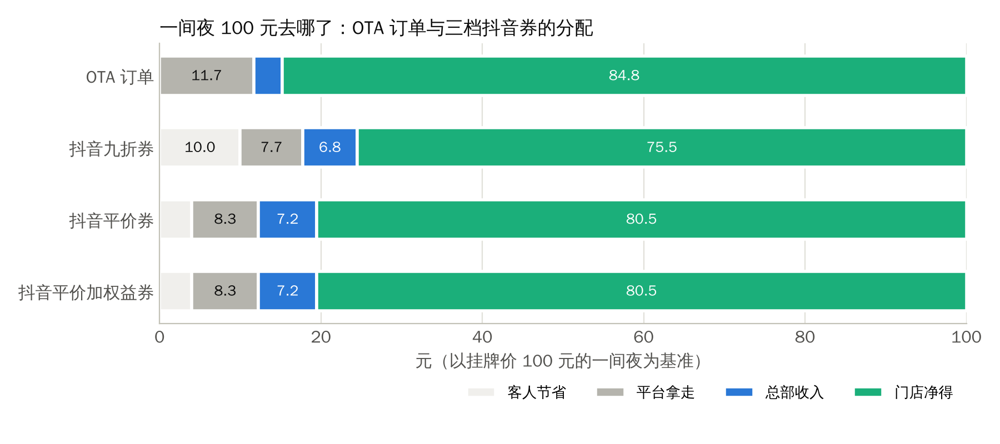
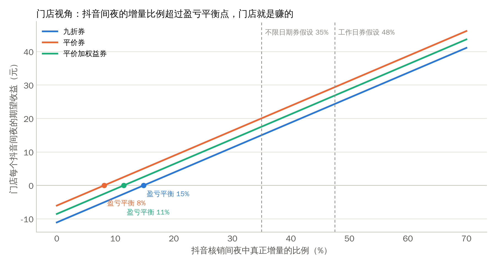
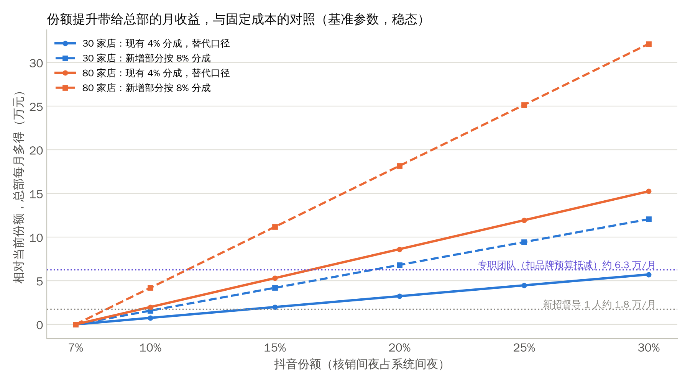
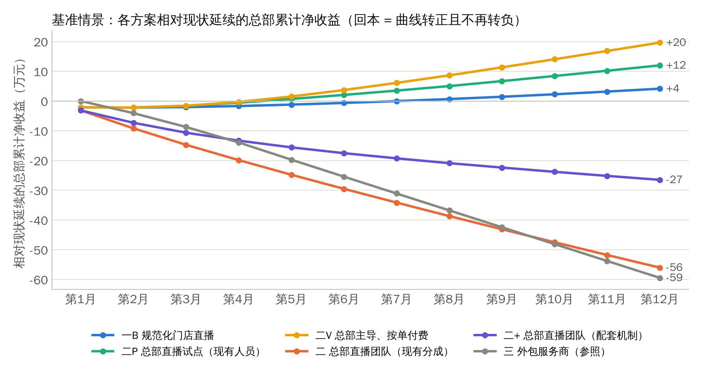
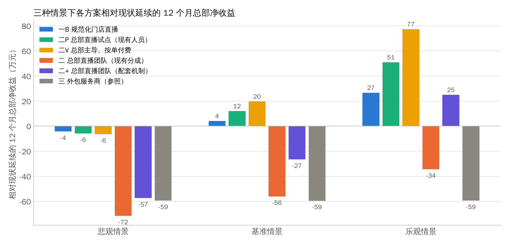
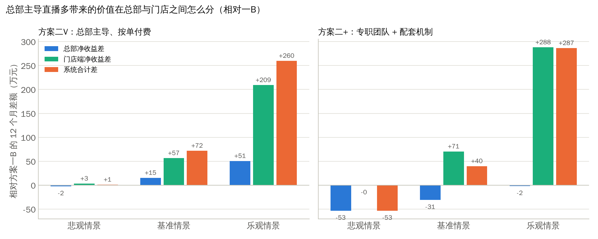
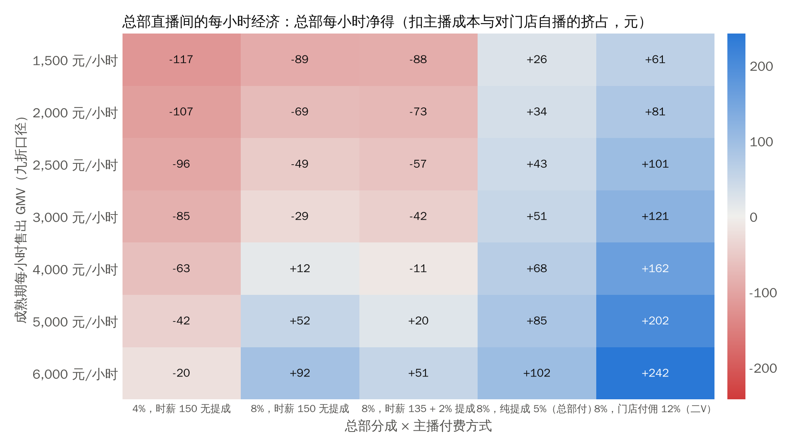

**文档性质**：供股东会决策使用。正文约 25 分钟可读完；第一章是一页摘要，后面各章是支撑材料。配套文件：《住小叮抖音直播财务模型.xlsx》（参数可调）、研究笔记（来源逐条可查）。

**本版的变化**：按决策人的两点要求重做了计算。一是以"抖音订单占比目前约 7%"为基线校准模型，把份额提升作为主线；二是把总部的收入、成本与回本速度作为核心决策标准（"12 个月才能回本就不投入"），门店与系统视角降为约束条件。

**数据口径**：公司事实来自决策人提供的数据（2026 年 10 月）；外部数据来自公开来源，附录 C 逐条列出，附录 D 记录核验状态；凡标注"假设"的参数，均在模型假设表中可改，改后全部结果自动重算。金额单位为人民币元，"万"指万元；"份额"指抖音核销间夜占全系统间夜的比例。

# 一、决策摘要

## 1.1 要股东拍板的三件事

| 决策 | 备选项 | 本文建议 |
|---|---|---|
| 总部要不要为抖音直播投固定成本 | 不投，用现有人员做；新招 1 名直播督导；组建 4 人专职团队 | **现阶段不投任何固定人力成本。** 按 7% 份额校准后，总部从抖音拿到的分成每月只有约 {{BASE_HQ_TAKE0}} 万，份额每提升 1 个百分点总部每月只多得约 {{HQ_PER_PT_30}} 元（30 家店）。新招督导要份额提升 {{SUP_BE30}} 才打平，专职团队要提升 {{DEC_B2M_BE30}}，12 个月内都回不了本。固定成本只在两个条件同时成立时再谈：门店数到 80 家左右，且总部主导订单的分成机制（8%）已签署 |
| 用什么结构把份额从 7% 做上去 | 门店自播规范化；总部用现有人员试点直播；按单付费的兼职主播或达人；专职团队；外包服务商 | **"零增量固定成本"的组合**：规范化门店直播（一B，由运营部现有人员兼任督导）、现有品牌营销人员做总部直播试点（二P）、第 3 月起引入按核销付佣金的兼职主播或达人（二V），每家新店开业前后由总部直播间预售约 {{PRESALE_V_BASE}} 张券，总部主导订单的分成提至 8%。基准情景下这条路线 12 个月总部比现状多赚 {{REL_V_基准}} 万；一次性现金投入压到零时{{DEC_V_PB_基准_ZERO}} 回本，悲观情景相对现状 {{DEC_V_REL_悲观_ZERO}} 万；产品同步改为周日至周四可用的平价加权益券 |
| 由哪个部门牵头 | 运营部；品牌部 | **运营部牵头渠道，品牌部负责内容、试点直播与投放，数字化建设负责清分与度量**；分工表见第八章 |

## 1.2 五个核心结论

1. **抖音今天是一个 7% 份额、总部每月约 {{BASE_HQ_TOTAL0}} 万收入的渠道。** 按 7% 份额计，全系统每月约 {{SYS_NIGHTS0}} 个间夜中有 {{BASE_NIGHTS0}} 个来自抖音，核销 GMV 约 {{BASE_RED0}} 万元、售出约 {{BASE_SOLD0}} 万元；总部拿到 4% 分成约 {{BASE_HQ_TAKE0}} 万，加上这些订单的 3.5% 管理费约 {{BASE_HQ_FEE0}} 万，合计约 {{BASE_HQ_TOTAL0}} 万，与上月的 {{BASE_HQ_COMM}} 万基本吻合。若把 4 万理解为纯 4% 分成，核销 GMV 要到 {{OLD_RED0}} 万、份额约 {{OLD_SHARE0}}，与 7% 矛盾；本文按 7% 校准，模型可一键切换（第二章）。
2. **总部从抖音赚的是小钱，门店赚的是大钱。** 一个抖音间夜，总部净得 {{HQ_SUB_GAIN}} 元（替代 OTA 订单）到 {{HQ_INC_GAIN}} 元（填补空房）；份额每提升 1 个百分点，总部每月多得约 {{HQ_PER_PT_30}} 元（30 家店）或 {{HQ_PER_PT_12}} 元（80 家店）。份额从 7% 做到 15%，总部每月多得 {{SH30_15_DSUB}} 到 {{SH30_15_DMIX}} 万（30 家店）、{{SH80_15_DSUB}} 万以上（80 家店）；同一件事门店每月多得 {{SH30_15_STORE}} 万（30 家店）。这就是总部任何投入的天花板，也是"让门店出钱"的依据。
3. **因此任何固定人力都回不了本。** 新招 1 名直播督导（含社保约 {{SUP_COST}} 万/月）要份额提升 {{SUP_BE30}}（30 家店）或 {{SUP_BE12}}（80 家店）才打平，基准情景 12 个月内不回本（相对现状 {{DEC_B1_REL_基准_SUP}} 万）；4 人专职团队加投流（扣掉门店分担与品牌预算抵减后仍约 {{DEC_B2M_MCOST}} 万/月）要提升 {{DEC_B2M_BE30}}（30 家店）或 {{DEC_B2M_BE12}}（80 家店），基准情景 12 个月相对现状少 {{DEC_B2M_REL_基准_ABS}} 万，只有乐观情景在{{DEC_B2M_PB_乐观}} 回本。专职团队不是能力问题，是分成结构和规模问题。
4. **能通过回本规则的，是零增量固定成本加分成机制的组合。** 规范化门店直播由运营部现有人员兼任督导，现有品牌营销人员用品牌号做总部直播试点，第 3 月起引入按核销付佣金（{{V_COMM_BASE}}，从门店到账划转）的兼职主播或达人，总部主导订单的分成提到 8%。最接近纯增量的一块是新店开业预售：未来 12 个月约 50 家新店，每店开业前后由总部直播间预售 {{PRESALE_V_BASE}} 张券（假设），新店爬坡期的空房让这些间夜大多是真增量。这条路线（方案二V）基准情景 12 个月总部比现状多赚 {{REL_V_基准}} 万、乐观 {{REL_V_乐观}} 万、悲观 {{REL_V_悲观}} 万；把一次性现金投入（培训、试点设备）压到零后，基准情景{{DEC_V_PB_基准_ZERO}} 回本、现金谷底只有 {{DEC_V_TROUGH_基准_ZERO}} 万，乐观情景{{DEC_V_PB_乐观_ZERO}} 回本，悲观情景相对现状 {{DEC_V_REL_悲观_ZERO}} 万，三项回本条件同时满足。再加 1% 渠道运营费，基准情景 12 个月多赚 {{DEC_V_REL_基准_CHFEE}} 万、{{DEC_V_PB_基准_CHFEE}} 回本。门店端在基准情景比现状多赚 {{STOREDIFF_V_基准}} 万。
5. **份额能不能上去，取决于门店，不取决于总部播多少。** 份额上不去的根源是门店在旺日关库存、加盟店抵触折扣券；平台规则（禁止临时关库存、划线价须真实、到店无房退一赔一以上）在帮我们。基准假设下 12 个月末份额只能到 {{SHARE12_V_基准}}（二V）到 {{SHARE12_B2M_基准}}（专职团队），乐观情景 {{SHARE12_V_乐观}} 到 {{SHARE12_B2M_乐观}}；要到 20% 以上，靠的是门店数翻倍、每店产出提升和新店开业前的预售，而不是总部直播间多播几百小时。产品改为周日至周四可用的平价加权益券、总部收回库存权限、参与协议和提成清分，仍然是第一步。

## 1.3 建议的路径与投入

| 阶段 | 时间 | 做什么 | 总部投入（基准） | 预期结果（基准） |
|---|---|---|---|---|
| 阶段 0：零增量成本启动 | 第 1 月 | 工作日平价加权益券、划线价合规；来客权限收紧为"总部管商品、门店只核销"；门店参与协议与提成清分；运营部副总监与片区负责人兼任直播督导；内部培训与 SOP（方案一B） | 一次性 0 到 {{DEC_B1_ONEOFF}} 万（外部讲师可不请），每月约 {{DEC_B1_MCOST}} 万 | 12 个月总部比现状多 {{REL_B1_基准}} 万，{{PB_B1_基准}} 回本（一次性投入为零时{{DEC_B1_PB_基准_ZERO}}）；门店端比现状多 {{STOREDIFF_B1_基准}} 万 |
| 阶段 1：总部直播试点 | 第 2 月起 | 现有品牌营销人员用品牌号开播，每月 {{PILOT_HOURS_BASE}} 小时，并承接新店开业预售（每店约 {{PRESALE_V_BASE}} 张）；设备 {{PILOT_EQUIP}} 万从现有品牌预算出；总部主导订单分成 8%（方案二P） | 不新增人力；每月约 {{DEC_P_MCOST}} 万杂费 | 12 个月总部比现状多 {{REL_P_基准}} 万；拿到"每小时卖多少"的实测数据 |
| 阶段 2：按单付费扩量 | 第 3 月起 | 引入 2 到 4 名兼职主播或达人，按核销 GMV 付 {{V_COMM_BASE}} 佣金（从门店到账划转），每月 {{V_HOURS_BASE}} 小时；总部只出协调杂费（方案二V） | 每月约 {{DEC_V_MCOST}} 万 | 12 个月总部比现状多 {{REL_V_基准}} 万（乐观 {{REL_V_乐观}} 万），{{PB_V_基准}} 回本，一次性投入为零时{{DEC_V_PB_基准_ZERO}} 回本；门店端比现状多 {{STOREDIFF_V_基准}} 万 |
| 决策关卡 | 第 6 月与门店数到 60 家时 | 按第九章的关卡评估是否组建专职团队：实测总部主导订单的月核销 GMV 是否已经覆盖团队成本 | — | — |
| 可选：渠道运营费 | 阶段 0 起 | 按门店抖音核销 GMV 的 1% 向参与门店收取，覆盖督导、培训与清分成本 | — | 基准情景约 {{CHANNEL_FEE_1PCT}} 万/年；一B 与二V 的回本都提前到{{DEC_V_PB_基准_CHFEE}} |

## 1.4 最大的三个风险

- **核销率低于估计。** 行业酒旅团购核销率不足 50%，公司自估 60%，模型基准按 {{REDEEM_BASE}} 计算、悲观 {{REDEEM_PESS}}、乐观 {{REDEEM_OPT}}。核销率从 {{REDEEM_BASE}} 降到 {{REDEEM_PESS}}，总部与门店的抖音收入约下降 {{REDEEM_DROP_PCT}}，悲观情景下零增量成本的路线也回不了本。
- **门店不配合，份额上不去。** 模型基准按 {{WB_BASE}} 的抖音买家"本来就会订本品牌"计算，替代间夜每夜让门店少赚 {{U_P1_LOSS}} 元（九折）或 {{U_P2_LOSS}} 元（平价）；如果替代率更高或平价券卖不动，门店会继续关库存，总部主导的直播卖出的券兑换不了。这是整条路线的前提，第一阶段要建立度量。
- **履约违规。** 门店拒绝核销或变相拒绝（说没房），平台会处罚到商品和门店，2026 年的假期专项逐次提高了赔付标准，责任主体是总部的来客店铺。机制上必须把"关库存"的权限从门店收回到总部，并把不可用日期写进商品。

# 二、现状与上月复盘

## 2.1 基础数据

| 项目 | 数值 | 说明 |
|---|---|---|
| 门店 | 北京 30 家，20 家总部代运营，10 家加盟商自管 | 店长多为总部员工，薪酬约 1 万元/月，记在门店损益 |
| 单店 | 约 100 间房，平均房价约 100 元/晚，入住率 85% 以上 | 很多门店 90% 以上，周末基本满房 |
| 系统月间夜与流水 | 约 {{SYS_NIGHTS0}} 间夜，约 {{SYS_REV_MONTH}} 万元 | 挂牌价口径 |
| 总部管理费 | 流水的 3.5%，约 {{HQ_FEE_MONTH}} 万元/月 | 模型按客人支付金额计提（可切换为按到账）；抖音订单同样计提 |
| OTA 结构 | 携程、美团佣金约 8%，另有 4% 由平台控价 | 客人看到的价格在 96 到 100 元之间，酒店按 96% 收款再扣 8% 佣金 |
| 抖音 | 通兑券约九折，90 天有效，过期自动退；订单占比约 {{SHARE0}} | 平台综合费率 8%（已含 0.6% 支付手续费，核验确认），总部抽 4%，门店到账 88%（模型 {{STORE_RATE_PCT}}）；门店可自设库存 |
| 组织 | 运营部 6 人（总监、副总监、质检、三个片区负责人） | 副总监管 OTA 与抖音运营；销售总账号与门店子账号归运营；品牌抖音号归品牌部，粉丝不到 1 万，1 人，月预算 2 万 |
| 扩张 | 未来 12 个月北京新增约 40 家，上海、深圳约 10 家 | 模型按月均新增约 4.2 家，第 12 月约 {{STORES12}} 家 |

## 2.2 基线校准：7% 份额与上月 4 万元

决策人提供了两项事实：当前抖音订单占比约 7%，上月总部从抖音拿到约 4 万元。两者需要放在同一口径下：

| 指标 | 按 7% 份额校准（本文采用） | 按"4 万 = 纯 4% 分成"倒推（旧口径） |
|---|---|---|
| 抖音核销间夜 | 约 {{BASE_NIGHTS0}} 间夜/月，占系统 {{SHARE0}}，平均每店 {{ST_DN0}} 间夜 | 约 11,111 间夜/月，占系统 {{OLD_SHARE0}} |
| 核销 GMV | 约 {{BASE_RED0}} 万元/月（九折券 90 元） | 约 {{OLD_RED0}} 万元/月 |
| 售出 GMV | 约 {{BASE_SOLD0}} 万元/月（按 {{REDEEM_BASE}} 核销率倒推，其余过期自动退） | 约 167 万元/月 |
| 总部 4% 分成 | 约 {{BASE_HQ_TAKE0}} 万元/月 | 4.0 万元/月 |
| 抖音订单的 3.5% 管理费 | 约 {{BASE_HQ_FEE0}} 万元/月 | 约 3.5 万元/月 |
| 总部从抖音订单的收入合计 | 约 {{BASE_HQ_TOTAL0}} 万元/月，与"4 万"吻合 | 约 7.5 万元/月，与"4 万"不符 |

两种口径只有一种能同时解释 7% 和 4 万：**上月的 4 万元是分成加管理费的合计（或 4% 按售出而非核销结算）**，对应核销 GMV 约 50 万元、份额 7%。本文据此校准；如果财务确认 4 万元是纯 4% 分成，把模型假设表的"基线校准方式"改为 2 即可，所有结果自动重算，但那意味着份额已经是 14.5%，"提升空间"要相应下调。

按校准后的基线，上月抖音对总部和门店的真实贡献：

| 指标 | 数值 | 推算方式 |
|---|---|---|
| 总部实际增量收入 | 约 {{RETRO_HQ}} 万元/月 | 4% 分成 {{BASE_HQ_TAKE0}} 万 + 抖音订单管理费 {{RETRO_DYFEE}} 万 − 被替代的 OTA 订单原本的管理费约 {{RETRO_SUBFEE}} 万（按不限日期券的替代率假设） |
| 门店端净收益变化 | 约 {{RETRO_STORE}} 万元/月（全系统） | 增量间夜的贡献减去替代间夜的损失，不含门店直播的时间成本；按不限日期券的增量比例 {{INC_ANY}} 推算 |

三个含义：

- **需求是真实的，但体量比"4 万纯分成"所暗示的小一半。** 没有培训、没有投流、没有机制，门店前台和店长做到了 7% 的份额；这个客群在抖音上有购买习惯，九折价位有吸引力。
- **总部口径下它是一笔小钱。** 总部每月从抖音订单多拿到的增量只有约 {{RETRO_HQ}} 万，而门店端的改善约 {{RETRO_STORE}} 万。这决定了后面所有关于"总部投入"的判断：总部能从份额提升中拿到的钱很有限，投入必须极小、或者让受益的门店分担。
- **我们对它几乎没有度量。** 目前没有场次、观看、转化、核销率、拒单率的系统数据。行业经验是门店矩阵的产出高度集中（蜜雪冰城 5,800 多个企业认证账号中，2023 年前 8 个月交易额过百万的只有 20 多个），住小叮大概率也是少数几家店贡献了大部分流水。第一阶段必须先把数据建起来。

## 2.3 现在的问题

| 问题 | 根源 | 本文对应的解法 |
|---|---|---|
| 门店在旺日关抖音库存，客人兑换不了 | 周末满房，抖音券替代的是全价订单；平台现在把"临时关闭库存"列为违规 | 商品层面设不可用日期（工作日券），总部收回库存权限，参与协议写明库存承诺（第七章） |
| 加盟店抵触低于售价的券 | 替代间夜每夜少赚约 {{U_P1_LOSS}} 元；而总部每单多赚 | 定价改为平价加权益；用单店损益表把账算给门店看；提成由核销门店划转给开播门店（第六、七章） |
| 总部没有为抖音投入的预算空间 | 总部分成只有 4%，份额每升 1 个百分点只多 {{HQ_PER_PT_30}} 元/月 | 零增量固定成本；总部主导订单分成 8%；按单付费；可选渠道运营费（第五、七章） |
| 账号与职责分散 | 品牌号在品牌部，销售总号与门店子账号在运营部，OTA 运营组职责里也写了自媒体运营 | 明确渠道牵头部门与分工（第八章） |
| 店长没有动力播 | 考核本店营收，但券是全系统通兑、按核销门店归属 | 开播门店提成与跨店归因（第七章） |

# 三、市场与同业

## 3.1 抖音酒旅的规模与走向

| 指标 | 数据 | 来源 |
|---|---|---|
| 抖音生活服务整体 | 2025 年支付 GMV 超 8,500 亿元，同比增长 59%；2026 年目标增速约 50% | 媒体口径（新浪财经、中新社等），附录 C-1 |
| 酒旅订单增速 | 2025 年酒旅团购订单 +42%，酒店民宿订单 +63%；2026 年春节酒店宾馆团购订单 +94%，中秋国庆酒店宾馆订单近 +79%（均为平台自报） | 抖音官方文旅数据报告，附录 C-2 |
| 抖音在在线酒店预订中的份额 | 2024 年约 3%（GMV 口径）；携程系约 70%，美团 13% 到 20% | 交银国际等估算，附录 C-3 |
| 直播的作用 | 2026 年官方口径：32% 的用户通过直播间下单酒店 | 抖音与迈点研究院《2026 抖音文旅消费趋势报告》（2026-06-11），附录 C-4 |
| 复购 | 超过 60% 的酒旅订单用户在 30 或 90 天内复购，平均复购周期 19 天 | 同上 |
| 核销率 | 行业酒旅团购核销率不足 50%（2026 年初行业数据，携程同类约 90%）；国信证券估算约 30%（含达人与度假囤券）；搜索型入口"抖省省"全品类首单核销率约 68% 到 75%（以餐饮为主，非酒旅数据） | 虎嗅 2026-03、国信证券 2025-07、21 财经，附录 C-5 |
| 日历房 | 订单占比不到 15%（2025 年中）；平台持续推动从囤券向可定日期的日历房迁移 | 国信证券估算，附录 C-5 |

对住小叮的含义：这个渠道还在高速增长，住小叮 7% 的份额已经是抖音在全行业酒店预订份额（约 3%）的两倍多，说明经济型、刚需、自播为主的业态与抖音客群匹配；但平台整体核销率低，平台在把流量导向日历房和低价活动，经济型连锁拿到"免费流量"的空间在收窄，自播和搜索型成交是更可靠的路径。

## 3.2 规则变化：四件直接影响方案的事

**费率。** 住宿类目软件服务费自 2024 年 7 月 1 日起由 4.5% 升至 8%。核验确认商家后台显示的 8% 是综合费率，由 7.4% 团购服务费与 0.6% 支付手续费构成，支付手续费不在 8% 之外另收，公司口径的"抖音拿 8%、门店到账 88%"成立。2026 年 8 月 10 日起经豆包入口成交的酒店订单按 11.4% 加 0.6% 约 12% 收取，同一后台显示其他类目的豆包渠道费率普遍比主站高约 4 个百分点；商户合作协议保留提前 7 日通知调整费率的权利（附录 C-6）。费率风险不在今天的 8%，而在渠道差异化加价会不会扩散到主站。

**履约。** 2024 年 12 月的履约细则规定，拒单、到场前推翻、到店无房分别屏蔽货架 3、14、30 天，到店无房补差上限为首晚房费 3 倍、无法履约"退一赔三"（该细则针对酒旅代理商商品，是否同样适用直营酒店未见原文）；2026 年五一专项把确认后无法履约的差价赔付上限提至订单金额 3 倍（暑期专项又回到首晚房费 3 倍，说明尚未常态化）；2026 年 7 月 1 日启动的暑期专项明确禁止"临时关闭库存、无正当理由拒单、区别对待、临时加价"，违规可警告、封禁商品、门店禁售、扣罚保证金，并要求直播和视频清晰展示价格与特殊日期加价，专项期间处置了 7,628 个违规直播间；中秋国庆专项对有"到店没房"记录的酒店主动电话核实，确认后退一赔一（另有官方口径为最高退一赔三）并直接下架商品（附录 C-7）。这些专项规则虽按假期发布，但方向一致且逐次加码，门店自行关库存在规则上已经是品牌级的风险。

**价格展示。** 商户合作协议与平台价格规范要求划线价真实、有依据（门市价、线下价目、指导价），禁止虚构或夸大划线价，并持续打击虚假优惠和不合理低价（附录 C-8）。核验在协议、规范和公开报道中都没有找到"团购价必须低于划线价"或"无优惠商品不得上架"的明文，规范只把折扣率定义为团购价除以划线价，"让利不少于 1 元"之类的门槛只出现在特定活动规则里。因此"平价券"在规则上可行，能否上架以来客后台的提交校验为准；稳妥做法仍是划线价用有真实依据的门市价、团购价 96 元。

**OTA 最低价条款。** 2026 年 7 月 25 日市场监管总局对携程作出处罚（国市监处罚〔2026〕29 号），认定要求酒店独家合作构成限定交易、强制"全网最低价"构成附加不合理交易条件，罚没合计 51.79 亿元（没收违法所得 16.58 亿元、罚款 35.21 亿元），另责令全额退还强制扣除的订单储备金 1.22 亿元；携程同日公布五方面 19 项整改，承诺停止不合理的"全网最低价"要求、全面取消平台调整商家价格的合同条款，调价助手已于 3 月下线、挂牌通自当日下线。9 月 15 日市场监管总局会同文旅部对美团、抖音、京东、携程、同程、飞猪召开行政指导会，要求防范化解独家合作、"全网最低价"等"内卷"问题；9 月 19 日北京市监局依据反不正当竞争法和电子商务法对美团、飞猪、同程、途家立案调查，官方通报未点明事由，媒体报道指向竞价排名与全网最低价要求，截至 11 月初未见处罚结果（附录 C-9）。此前 OTA 的处置方式是系统比价后用"调价助手"自动下调卖价、差价由酒店承担，不配合者警告、限流、摘牌，这与公司"偶有警告"的经历一致。核验在携程处罚决定书和公开流传的美团酒店违规细则中都没有找到把非指定日期通兑券纳入比价的规则，两者的比价口径都是同一酒店同房型的跨平台价格或前台报价，行业访谈也称 OTA 尚未抓取直播间价格；但平台后台规则不可读，不能完全排除。OTA 对抖音价格的约束力明显减弱，但监管同时在压制"价格内卷"，深折扣的空间也在收窄。

## 3.3 同业怎么做

| 企业 | 组织方式 | 公开成绩 | 对加盟店的处理 |
|---|---|---|---|
| 华住（汉庭、全季等） | 集团官号 @华住会酒店推荐（2024 年 10 月约 150 万粉丝，2025 年 10 月约 536 万，每天常态化直播）、区域矩阵号、门店员工出镜与达人；集团统一管理货品。门店职人号出自行业评论，未能核对 | 2024 年初 10 多天支付 GMV 超 8,000 万元、参与门店超 6,000 家；2024 年暑期峰值日直播超 20 小时、单日支付 GMV 约 300 万元（媒体推测） | 通兑券全国通用，集团设计方案下发门店；2025 年暑期优惠含抖音平台补贴，"营销费用集团出、门店只让价"属行业评论口径，分担比例未公开 |
| 首旅如家 | 品牌直播间配合平台大促 | 2025 年 7 月 16 日单日成交 GMV 突破 1,000 万元，6,000 余家门店参与（来源页面已失效，未能核对） | 通兑预售券 7 到 8 折，日历房 85 折 |
| 锦江 | 总部直播验证后，推"AI + 门店员工直播矩阵" | 2025 年双 11 视频号累计成交 138 万元、近 7,000 单（企业自报，环球旅讯转载）；多渠道通兑券 79 到 169 元/晚 | — |
| 尚美数智（尚客优） | 总部集中直播团队专攻客房（2022 年报道称约 20 人，来源页面已失效，未能核对）；区域总部自播 | 区域总部首场约 2.8 万元（2023-12） | — |
| 亚朵 | 以品牌自播为主，2023 年 342 场 | 零售旗舰店某场双 11 直播 90% 流量来自付费投流 | — |
| 东呈、格林、途客、优程 | 无公开的抖音直播组织信息 | — | — |
| 第三方代运营 | 酒旅专项报价（业内访谈口径，观点指数 2024）：基础服务费 4 到 5 万元/年加 8% 到 12% 佣金；或月费 6,000 元加 10% 佣金；代播 500 到 2,000 元/小时 | — | — |

来源见附录 C-10 到 C-13。三个观察：第一，头部集团全部采用"总部号加门店号"的双层结构，不是二选一；第二，没有任何一家公开过团队人数、归属部门或抖音占总预订的比例，也没有公开总部与加盟店之间关于抖音订单的分成机制，这部分只能靠我们自己设计；第三，超经济型、青旅、胶囊类品牌在抖音直播的公开成绩几乎为零，住小叮没有现成的对标，7% 的份额本身就是这个细分业态里少见的数据点。

# 四、核心账：总部和门店各赚多少

## 4.1 单位经济

以挂牌价 100 元的一间夜为基准，四种成交方式下各方拿到多少：

{{TABLE_UNIT}}

说明：OTA 订单的平台拿走为 4 元控价加 96 元的 8% 佣金；总部管理费按客人支付金额的 3.5% 计提（模型可切换为按门店到账）；变动成本为假设（清洁、布草、水电、耗材），可在模型中修改。

从总部的角度，一个抖音间夜值多少钱取决于它替代了什么：

| 口径 | 现有 4% 分成 | 总部主导订单分成 8% |
|---|---|---|
| 替代一个 OTA 间夜：总部净得 | {{HQ_SUB_GAIN}} 元 | {{HQ_SUB_GAIN_M}} 元 |
| 填补一个空房：总部净得 | {{HQ_INC_GAIN}} 元 | {{HQ_INC_GAIN_M}} 元 |

替代口径下总部净得的是 4% 分成加管理费差额（抖音券 90 元比挂牌价低 10 元，管理费少 0.35 元）；增量口径下总部还多拿一份本来没有的管理费。对总部来说替代和增量都是正数，这是总部与门店利益错位的根源。

## 4.2 替代还是增量：门店的账

抖音券卖出的一个间夜，有两种可能：一是客人本来就会在 OTA 订我们（替代），二是客人本来不会来，或者本来房间空着（增量）。两种情况下门店和总部的得失完全不同：

{{TABLE_SUB}}

**九折券每替代一个间夜，门店少赚 {{U_P1_LOSS}} 元，总部多赚 {{U_P1_HQGAIN}} 元，客人省 10 元。** 门店是唯一的输家；而每一个增量间夜，门店多赚 {{U_P1_CONTRIB}} 元。门店是否划算，取决于抖音间夜里真增量的比例，模型把它拆成两个因素：核销落在满房日的比例（满房日的抖音间夜一定是替代），以及抖音买家中"本来就会订本品牌"的比例。

{{TABLE_EXPECT}}

两个关键判断：

- **门店的盈亏平衡点很低。** 只要超过 {{BE_P1}}（九折）、{{BE_P2}}（平价）、{{BE_P3}}（平价加权益）的抖音间夜是真增量，门店就是赚的。85% 的入住率意味着平日每晚约有 15 间空房，平日的抖音单大概率是在填空房。
- **周末是另一回事。** 周末满房时，每一个抖音间夜都在替代全价订单，门店关库存是对的。所以机制的核心不是"禁止关库存"，而是"把周末从券里拿掉"。工作日券把增量比例从 {{INC_ANY}} 提到 {{INC_WD}}（模型假设），门店每个抖音间夜的期望收益从 {{U_P1_EXP_ANY}} 元升到 {{U_P1_EXP_WD}} 元。

这些比例目前都是假设。行业可参照的数据是度假与高星酒店直播的新客比例约 71% 到 80%（Club Med 2025 年实景店播核销客人中 80% 为新客，单一报道口径；洲际 2026 年活动首周新客下单占比 71%，企业披露），经济型连锁没有公开数据，也没有任何研究量化过"抖音订单替代了多少 OTA 订单"。模型按更保守的"平日核销中一半是真增量"（基准，区间 30% 到 65%）计算，叠加满房日因素后，不限日期券的真增量比例为 {{INC_ANY}}，工作日券为 {{INC_WD}}。第一阶段的首要任务之一就是用订单匹配、问卷和门店对照测出住小叮自己的数字。

## 4.3 份额值多少钱：总部投入的天花板

把份额从 7% 提升到目标值，总部和门店每月各多得多少（基准参数，稳态，不含任何投入）：

当前 30 家店：

{{TABLE_SHARE_30}}

12 个月后约 80 家店：

{{TABLE_SHARE_80}}

读法：

- **份额每提升 1 个百分点，总部每月多得约 {{HQ_PER_PT_30}} 元（30 家店）或 {{HQ_PER_PT_12}} 元（80 家店），替代口径。** 这是最保守的算法（新增的抖音间夜全部替代 OTA 订单）；按模型的混合口径（工作日券 {{INC_WD}} 是增量）大约高 50%（15% 份额时 30 家店为 {{SH30_15_DMIX}} 万）。"总部月增量：替代口径"这一列就是总部每月养得起的固定成本上限：份额到 15%，30 家店每月只能养得起 {{SH30_15_DSUB}} 万的固定成本，80 家店 {{SH80_15_DSUB}} 万；把新增部分的分成提到 8%，80 家店到 15% 时每月多得 {{SH80_15_DM8}} 万，才够一个专职团队。
- **同一件事门店的收益是总部的 6 到 8 倍。** 份额到 15%，30 家店的门店端每月多得 {{SH30_15_STORE}} 万。这就是为什么投入应该由门店分担、或者通过总部主导订单的 8% 分成来回收。
- **份额有物理上限。** "新增间夜占系统空房比例"一列说明：30 家店要把份额做到 30%，新增的抖音间夜要填掉 {{SH30_30_EMPTY}} 的空房，平日空房基本填满、周末无房可填。份额的大头来自门店数翻倍和新店开业前三个月的空房，而不是在现有门店上无限加量。

# 五、六个组织方案的对比

## 5.1 方案定义

| 方案 | 定义 | 总部投入 |
|---|---|---|
| 一A 门店自播，现状延续 | 各店子账号自播，前台或店长出镜，无培训、无激励、无投流，券仍为不限日期（即上月的做法） | 0 |
| 一B 规范化门店直播 | 在一A 基础上：运营部副总监与片区负责人兼任直播督导（不新招，模型开关可改为新招）、内部培训与 SOP、每周开播 KPI、开播门店提成（由核销门店到账划转，总部清分）、产品与库存机制改造；门店设备（约 800 元/店）由门店自购 | 一次性 0 到 {{DEC_B1_ONEOFF}} 万，每月约 {{DEC_B1_MCOST}} 万 |
| 二P 总部直播试点（现有人员） | 在一B 基础上：现有品牌营销人员用品牌号开播，每月 {{PILOT_HOURS_BASE}} 小时，成熟期每小时售出 {{PILOT_GPH_BASE}} 元（假设）；承接新店开业预售，每家新店 {{PRESALE_V_BASE}} 张（假设，增量比例 {{PRESALE_INC_BASE}}）；设备 {{PILOT_EQUIP}} 万；总部主导订单的总部分成 8% | 不新增人力；一次性 {{DEC_P_ONEOFF}} 万（含一B），每月约 {{DEC_P_MCOST}} 万 |
| 二V 总部主导、按单付费 | 在二P 基础上：第 {{V_START}} 月起引入兼职主播或达人，每月 {{V_HOURS_BASE}} 小时，成熟期每小时售出 {{V_GPH_BASE}} 元（假设），按核销 GMV 付 {{V_COMM_BASE}} 佣金，佣金从核销门店到账中划转；总部只出排班、素材、清分的协调杂费 | 一次性 {{DEC_V_ONEOFF}} 万（含一B），每月约 {{DEC_V_MCOST}} 万 |
| 二 总部直播团队（现有分成） | 在一B 基础上：4 人专职团队（运营负责人、主播、中控兼剪辑、投手兼内容）加兼职备播主播、设备、场地、投流，同样承接新店开业预售；现有品牌营销人员派驻进团队、月预算转为直播内容预算，因此抵减；分成仍为抖音 8%、总部 4%、门店 88% | 团队含社保与备播约 {{TEAM_SAL}} 万/月，投流 3 万/月，抵减品牌预算与人员 {{BRAND_CREDIT}} 万/月；稳态净成本约 {{DEC_B2_MCOST}} 万/月 |
| 二+ 总部直播团队 + 配套机制 | 同方案二，另加两条机制：团队直播间和投流带来的订单，总部分成提至 8%（门店到账 84%）；投流预算由门店分担一半 | 稳态净成本约 {{DEC_B2M_MCOST}} 万/月 |
| 三 外包服务商（参照） | 门店自播维持现状，另请服务商代播每月 {{C_HOURS}} 小时（每小时产出与总部直播间按同一假设）：月固定费 0.8 万、售出 GMV 的 10% 佣金、投流 2 万/月 | 成熟期约 {{C_COST_M12}} 万/月 |

方案三只作参照：服务商按售出 GMV 收 8% 到 12% 的佣金，而总部按核销只拿 4%，总部独自承担服务商费用在结构上不成立，除非门店分担。

二V 里的"按单付费"和达人代播的区别在于谁付佣金、按什么付。达人常见佣金 10% 到 25%，按售出或核销结算不一；二V 按核销 GMV 付 {{V_COMM_BASE}}，由核销门店从到账中划转，门店只为真正入住的客人付佣，平价券下门店在这些订单上的净得仍高于九折自播单（见下表的"门店付佣"列与第六章）。总部付佣则不成立：总部每个抖音间夜的全部收入只有 {{HQ_INC_GAIN}} 元，付不起 13.5 元的佣金。此外达人直播的酒旅订单核销率仅个位数到 30%，头部达人还要求专属库存和低于 OTA 约 12% 的渠道价，与住小叮高入住率的供需状态相反，所以二V 优先用兼职主播和腰部本地达人，不追头部达人。

{{TABLE_KOL}}

## 5.2 定性对比

| 维度 | 一A 现状延续 | 一B 规范化门店直播 | 二P / 二V 总部试点与按单付费 | 二 / 二+ 专职团队 | 三 外包 |
|---|---|---|---|---|---|
| 总部成本 | 零 | 每月 {{DEC_B1_MCOST}} 万，一次性 0 到 {{DEC_B1_ONEOFF}} 万 | 每月 {{DEC_P_MCOST}} 到 {{DEC_V_MCOST}} 万；佣金由门店按核销付 | 稳态每月 {{DEC_B2M_MCOST}} 到 {{DEC_B2_MCOST}} 万（扣抵减后），一次性约 {{DEC_B2_ONEOFF}} 万 | 成熟期约 {{C_COST_M12}} 万/月，无沉淀 |
| 收益 | 产出随新鲜感衰减（悲观情景每月 -{{A_DRIFT_PESS}}） | 产出提升 15% 到 50%（假设），衰减得到控制 | 多一个总部直播间，产出随主播人数线性扩展；8% 分成 | 稳定产出的直播间，可投流放大；新城市开店前能预售 | 产出取决于服务商，合同期短 |
| 风险 | 质量参差、违规连坐、员工离职带走账号、拒单投诉 | 同左但可控；现有人员兼任，带宽紧张 | 品牌人员的本职工作被挤占；兼职主播质量参差、流动大；佣金制下有冲 GMV 压价的动机 | 主播年流失率高（行业 60% 到 100%）；团队产出不达预期；总部固定成本 | 服务商为冲 GMV 压价、核销率低；账号与客户资产在服务商手里 |
| 可管理性 | 弱，没有数据 | 中，有 KPI、巡检、清分 | 中，话术与价格由总部统一，执行靠兼职 | 强，集中可控 | 中，靠合同 |
| 可扩展性 | 随门店数线性增长，新店冷启动慢 | 同左，新店有培训包 | 按人数扩展，成本随 GMV 走 | 固定成本摊薄，80 家店时单位成本减半 | 可随时放大或停止 |
| 对组织的影响 | 无 | 运营部现有人员多一项职责 | 品牌部多一项职责；清分系统 | 新设团队；品牌传播职能并入 | 无内部能力沉淀 |
| 回本（基准） | — | {{PB_B1_基准}}，一次性投入为零时{{DEC_B1_PB_基准_ZERO}} | 二V {{PB_V_基准}}，一次性投入为零时{{DEC_V_PB_基准_ZERO}} | 12 个月内不回本 | 12 个月内不回本 |

## 5.3 总部口径的财务结果与回本

模型按 12 个月、三种情景计算，门店数从 30 家增至约 {{STORES12}} 家，各方案按第 2 月启动、现有九折券计算，便于与现状比较；现状延续和方案三的门店自播部分按不限日期券的现状口径，其余方案按工作日券口径。总部口径是"增量净收益"：抖音分成、抖音订单的管理费、总部主导订单的加成分成、减去被替代订单原有的管理费、再减去总部成本。"相对现状延续"指该方案 12 个月总部净收益减去现状延续的总部净收益；"回本月"指相对现状延续的累计总部净收益转正且此后到第 12 月不再转负的最早月份。回本规则：决策人要求 12 个月才能回本的投入一律不做，本文以 {{PAYBACK_RULE}} 个月为通过线（模型可改）。

{{TABLE_HQ_DECISION}}

同一组方案的收益与份额：

{{TABLE_HQ_DECISION2}}

三情景汇总：

{{TABLE_SCEN_SUMMARY}}

基准情景的明细：

{{TABLE_SCEN_基准}}

悲观与乐观情景的明细见附录 B。四点解读：

- **回本规则是三道门，默认参数下没有方案通过；通过的办法是把一次性现金投入压到零。** 三道门是：基准情景回本月不超过通过线（含固定人头 {{PAYBACK_RULE}} 个月，零固定成本 {{PAYBACK_RULE_VAR}} 个月）、基准情景现金谷底不低于 {{TROUGH_RULE}} 万、悲观情景 12 个月亏损不超过 {{PESS_LOSS_RULE}} 万。默认参数下固定人头方案不回本；零固定成本方案的回本月已在 6 个月内（二P {{PB_P_基准}}、二V {{PB_V_基准}}），但悲观情景亏损超过上限。一B 和二V 的一次性投入（培训 2 万、试点设备 1.5 万）如果改为内部讲师、设备从现有品牌预算出、门店设备自购，总部的现金投入只剩每月 {{DEC_B1_MCOST_ZERO}} 到 {{DEC_V_MCOST_ZERO}} 万的培训与协调杂费：基准情景一B {{DEC_B1_PB_基准_ZERO}} 回本、二P {{DEC_P_PB_基准_ZERO}} 回本、二V {{DEC_V_PB_基准_ZERO}} 回本，乐观情景二V {{DEC_V_PB_乐观_ZERO}} 回本，悲观情景一B {{DEC_B1_REL_悲观_ZERO}} 万、二V {{DEC_V_REL_悲观_ZERO}} 万，二V 的现金谷底 {{DEC_V_TROUGH_基准_ZERO}} 万，三项条件全部满足（一B {{DEC_B1_RULE_ZERO}}、二P {{DEC_P_RULE_ZERO}}、二V {{DEC_V_RULE_ZERO}}）。
- **二V 是总部口径下最好的结构。** 它的收入来自三处：规范化后门店自播的分成、总部主导订单（试点直播间与按单付费主播）的 8% 分成、新店开业预售（每店 {{PRESALE_V_BASE}} 张券，增量比例 {{PRESALE_INC_BASE}}，同样按 8% 分成）；它的成本几乎全是变动的（佣金由门店按核销付）。基准情景 12 个月相对现状多 {{REL_V_基准}} 万，乐观 {{REL_V_乐观}} 万，悲观 {{REL_V_悲观}} 万；第 12 月份额 {{SHARE12_V_基准}}（乐观 {{SHARE12_V_乐观}}）。
- **专职团队在现有分成下对总部每年亏 {{DEC_B2_REL_基准_ABS}} 万，配套机制后仍亏 {{DEC_B2M_REL_基准_ABS}} 万（基准）。** 原因很简单：总部每卖出 1 元券，核销后只拿到约 {{S_TAKE_FEN}} 分的增量收入，团队加投流每月要多卖出约 {{BREAKEVEN_SOLD_MONTH_B2}} 万元才能打平（配套机制后约 {{BREAKEVEN_SOLD_MONTH}} 万元）。乐观情景下二+ 在{{DEC_B2M_PB_乐观}} 回本、12 个月多 {{DEC_B2M_REL_乐观}} 万，但那要求成熟期每小时售出 6,000 元、投流 ROI 7、核销率 65%、新店按计划开业同时成立。如果品牌营销人员与预算不并入团队，基准情景再少 {{BRAND_CREDIT_12M}} 万。
- **新招 1 名督导也不通过。** 把一B 改为新招督导（含社保 {{SUP_COST}} 万/月），基准情景 12 个月相对现状 {{DEC_B1_REL_基准_SUP}} 万、不回本，乐观情景{{DEC_B1_PB_乐观_SUP}} 回本。督导的工作必须由运营部现有人员兼任，这是运营部承接 50 家新店的同时多出来的一项职责，要在考核里体现。

两个补充口径：按 1% 渠道运营费重算，一B 基准情景 12 个月相对现状 {{DEC_B1_REL_基准_CHFEE}} 万、{{DEC_B1_PB_基准_CHFEE}} 回本，二V {{DEC_V_REL_基准_CHFEE}} 万、{{DEC_V_PB_基准_CHFEE}} 回本；按建议的平价加权益券重算，现状延续总部净收益为 {{NET_A_基准_T3}} 万（九折口径 {{NET_A_基准}} 万），二V 相对现状 {{REL_V_基准_T3}} 万，略高于九折口径。

## 5.4 总部主导直播的价值归谁

方案二V 相对一B：

{{TABLE_MARGINAL_V}}

方案二+ 相对一B：

{{TABLE_MARGINAL_M}}

两张表回答同一个问题：**总部多播出来的那部分，钱归谁？** 二V 多卖的券由门店按核销付佣金，总部拿 8%：基准情景总部多 {{MARG_V_基准_HQ}} 万、门店多 {{MARG_V_基准_ST}} 万，系统多 {{MARG_V_基准_SYS}} 万；悲观情景三方都略亏（{{MARG_V_悲观_SYS}} 万），因为佣金和协调成本在产出不足时收不回。专职团队（二+）多卖得更多，但总部要先垫 {{DEC_B2M_MCOST}} 万/月的固定成本，基准情景总部少 {{MARG_B2M_基准_HQ_ABS}} 万、门店多 {{MARG_B2M_基准_ST}} 万，价值几乎全部流向门店；只有乐观情景（系统多 {{MARG_B2M_乐观_SYS}} 万）才谈得上总部与门店双赢。所以专职团队的前提是分成机制，而分成机制的前提是门店已经从二V 里尝到甜头。

## 5.5 敏感性

方案二相对一B 的稳态每月边际净收益（总部口径，基准参数），对团队直播间产出和投流效率的敏感性：

{{TABLE_SENS1}}

对团队人力成本的敏感性：

{{TABLE_SENS2}}

读法：在现有分成（总部 4%）下，无论直播间每小时卖多少、投流 ROI 多高，总部口径的边际都是负的（两张矩阵的最大值分别为 {{SENS1_MAX}} 万和 {{SENS2_MAX}} 万），因为总部每卖出 1 元券核销后只拿到约 {{S_TAKE_FEN}} 分。它同时说明：**总部独自出钱投流在任何情况下都不划算**（保本 ROI 约 {{HQ_ADS_BREAKEVEN_ROI}}），投流必须由受益的门店分担，或者在总部主导订单上提高分成。二V 的按单付费结构正是把这个矛盾交给价格机制解决：主播的报酬随核销走，门店付钱，总部拿 8%。

## 5.6 判断

1. 现在不投固定人力。按总部口径，份额提升的价值太薄，任何固定成本在 12 个月内都回不了本；这不是团队能力问题，是 4% 分成和 30 家店的规模问题。
2. 做零增量固定成本的组合（一B 加二P 加二V），并把一次性现金投入压到零：基准情景 12 个月总部比现状多 {{REL_V_基准}} 万、{{DEC_V_PB_基准_ZERO}} 回本，门店端多 {{STOREDIFF_V_基准}} 万，同时拿到"每小时卖多少、核销率多少、增量比例多少"三个决定一切的实测数。
3. 专职团队只在三个条件同时满足后再上：门店数到 60 到 80 家；总部主导订单 8% 分成与投流分担的机制已被 80% 以上门店签署；实测总部主导订单的月核销 GMV 已经能覆盖团队成本（第九章的关卡），也就是先有收入再有编制，上了团队当月就能打平。
4. 产品与机制改造不受上述判断影响，它们本身就是零成本的，而且是份额能不能上去的前提。

# 六、通兑券定价：九折、平价、平价加权益

三档定价在同一套门店直播产出下的稳态比较（基准情景，当前 30 家店）：

{{TABLE_PRICING}}

模型对销量系数的假设：平价券销量为九折的 85%，平价加权益为 95%，改为工作日券后再乘以 85%。依据是对团购券折扣弹性的研究：对 19,978 个 Groupon 团购的分析（ISR 2018）发现折扣每加深 1%，销量反而下降 0.035% 到 0.256%，原因是深折扣被消费者当成低质量的信号，好评等第三方信息并不能抵消这一负效应；一篇国内酒店在线销量研究也提到折扣超过 10% 后销量不再随折扣加深而上升（原文未能核实，附录 C-14）。直播间的冲动购买属性会放大折扣的作用，所以模型仍对平价券打了折减，这个参数置信度低，需要用 A/B 测试验证。

四个结论：

- **三档对门店和总部的月收益差距不大，但风险和接受度差距很大。** 平价加权益的系统合计最高，门店接受度较高，OTA 价格冲突和平台"不合理低价"的风险最低。
- **按单付费需要平价。** 二V 的主播佣金从门店到账中出，九折券下门店在这些订单上每间夜净得会比 OTA 订单少 20 元以上，门店不会接受；平价加权益券下少得约 {{U_P3_LOSS}} 元加佣金，而这些订单大多是总部主导带来的增量，门店仍是净赚。
- **"平价"不等于不能上架。** 核验未发现平台禁止无折扣商品上架的明文，但划线价必须真实有据、折扣率按团购价除以划线价计算，所以平价券的划线价建议用门市价（118 到 128 元），团购价 96 元。前提是前台价目牌和近 12 个月的上门成交记录能证明这个门市价真实存在，否则有"虚构原价"的风险；如果没有，就以 OTA 挂牌价 100 元为划线价、团购价 96 元，并取得一份书面法律意见。这一项列为阶段 0 的前置核查。
- **九折留作工具。** 新店开业、上海深圳进入市场时用限时九折做冷启动，常态用平价加权益；在监管对"价格内卷"的口径明确前，不用于常态促销。

建议的产品结构：

| 产品 | 适用日期 | 价格 | 权益 | 用途 |
|---|---|---|---|---|
| 工作日券（主力） | 周日至周四入住，法定节假日除外 | 96 元 | 延迟退房至 14 点（非满房日）、行李寄存、饮用水 | 常态销售，所有参与门店 |
| 周末券 | 周五、周六 | 100 元 | 同上 | 可选；满房门店可不参与 |
| 城市券 | 北京通兑；上海、深圳开业后分城设券 | 按城市定 | 同上 | 避免跨城市库存承诺 |
| 限时促销券 | 指定周期 | 九折，不再更低 | — | 新店开业、新城市进入；淡季与大促视监管口径再定 |
| 日历房（第二阶段评估） | 指定日期直接下单 | 按日价 | — | 平台推动方向，彻底消除"无法兑换"问题，需要房态直连 |

# 七、机制设计：解决关库存与加盟店抵触

## 7.1 产品规则

- 工作日券作为主力，不可用日期在商品层面设定（每周五、六不可用，法定节假日不可用），不依赖门店临时操作。
- 周末、节假日的加价或不可用，必须写入商品详情；2026 年暑期专项起直播和视频中也必须清晰展示价格和特殊日期加价信息，到店临时加价属违规。
- 有效期维持 90 天，未预约前随时退、过期自动退（平台默认售后口径；预约后默认不退不换，详情页须写明）；券的面值和权益全系统统一。

## 7.2 库存与账号权限

- 抖音来客账号体系改为"总部统一管理商品、门店只做核销和订单处理"：总部账号建券、设库存、设不可用日期；门店子账号权限收缩为核销与订单管理，取消门店自行下架或关闭库存的权限。第三方接入文档显示多门店场景下只有品牌（总部）账号有商品操作权限，门店可开"核销员"岗位子账号，方向与本方案一致；但未取得来客官方帮助中心原文，阶段 0 要在来客后台实际确认权限配置，并和平台客户经理确认。
- 参与门店承诺每个工作日的最低可预约库存，建议按该店平日平均空房的一半设定（例如 8 间），由总部按日巡检预约接单情况。
- 拒单零容忍：无正当理由拒单或到店无房，按平台处罚金额全额由门店承担，并取消该店下一个月的开播提成；连续两次暂停该店参与。

## 7.3 分配规则

- 门店自播订单：核销门店到账 88% 不变。
- 开播门店或员工提成：按开播场次带来的核销 GMV 的 2.5% 计提（按核销而不是售出，避免为过期退款的券付提成），由核销门店的到账中划转，总部按月清分。跨店核销时，开播门店拿的就是这笔跨店奖励，解决"我播别人核销"的问题。行业参照是员工直播提成按核销计 2% 到 5%、跨店来源奖励 1% 到 3%（行业做法，未能逐条核对）。平台规则给了现成的实现路径：抖音职人账号协议规定激励金按订单金额乘以商家设定的比例计提、不高于 60%，核销后由支付机构从商家结算款中划扣并自动发放，商家代扣个税，只有绑定门店可核销的商品才计入；清分系统可以在此基础上做跨店划转。
- 总部主导订单（品牌号试点直播间、按单付费主播、将来的专职团队与投流带来的订单）：总部分成 {{B_HQ_TAKE_ROOM}}、门店到账 84%。同一张平价券，门店在这些订单上每间夜比门店自播订单少得约 3.8 元；理由是这些订单来自总部的组织与投入，对门店是额外增量，"谁投入谁分成"。这些订单同样只卖工作日券，避免在替代间夜上扩大门店损失。
- 按单付费主播的佣金：按核销 GMV 的 {{V_COMM_BASE}}（基准，区间 10% 到 15%）计提，由核销门店从到账中划转，总部代为结算并代扣个税；主播只为真正入住的客人拿钱，门店只为真正入住的客人付钱。
- 新店开业预售：新店开业前后的预售由总部直播间与按单付费主播承接，按总部主导订单分成；预售量与开业后的入住率挂钩，按店设上限，避免在爬坡期之后挤占全价订单。
- 投流基金（如组建专职团队）：投流预算由总部和门店各担一半，门店按抖音到账比例分摊；在此之前总部不投流。
- 渠道运营费（可选）：按门店抖音核销 GMV 的 1% 向参与门店收取，用于督导、培训与清分系统；基准情景约 {{CHANNEL_FEE_1PCT}} 万/年。
- 以上机制对代运营店和加盟自管店一视同仁，差别只在执行力度。与行业评论所称同业"集团出营销费、门店只让价"的做法相比，本方案让门店承担了开播提成（门店之间的划转）和主播佣金；对价是总部承担组织、培训和清分系统，并把分成的提高限定在总部主导的订单上。

## 7.4 合同与沟通

- 现有加盟合同没有参与总部渠道和保障库存的条款。建议用《抖音渠道参与协议》作为补充协议，内容包括：参与范围、库存承诺、不可用日期、分成与提成清分、主播佣金划转、违规处理、退出机制（提前 30 天书面通知）。对加盟自管店自愿签署，不签的不纳入通兑券适用门店。
- 用单店损益表和门店谈：按模型，一家典型门店改为工作日平价加权益券后，每月净收益变化约为 {{ST_PL_WD_P3}} 元（已扣除店长的直播时间成本），九折不限日期券约为 {{ST_PL_ANY_P1}} 元。

{{TABLE_STORE_PL}}

## 7.5 法律边界（依据法规文本的一般性理解，需法务复核）

- **总部约束门店的依据。** 商业特许经营管理条例要求被特许人"在统一的经营模式下开展经营"，合同应包含促销与广告宣传、消费者权益保护和赔偿责任的承担等内容，经营操作手册可作为合同附件。参与总部渠道、保障库存、执行统一券价、核销义务都可以写入补充协议或手册；但现行合同没有这些条款，依合同相对性总部不能单方强制，追加条款要提供对价（例如总部承担平台费或让出部分分成），并避开格式条款无效的情形。对门店自身销售的客房价格只能"建议"，不宜强制，以免触及转售价格维持的反垄断风险。
- **预售与预付。** 单用途商业预付卡管理办法字面上覆盖"同一品牌特许经营体系内兑付"的预付凭证，但抖音团购券由平台代收货款、核销后结算、过期自动退，公司不持有预收资金，实践中未被纳入备案管理；北京另有单用途预付卡管理条例，最高人民法院 2025 年 5 月施行的预付式消费司法解释将"收款不退、过期作废"等条款列为无效。结论：现行模式风险低；不要发展成储值型会员卡；建议取得一次书面法律意见并与北京市商务局确认备案口径。
- **直播与页面的合规要求。** 消费者权益保护法实施条例（2024 年 7 月施行）对直播营销和预付式消费有专门条款；网络直播营销管理办法要求真实、准确、全面发布信息；明码标价和禁止价格欺诈规定约束划线价与折扣基准；广告法禁止"最低价"等绝对化用语。落地要求：有效期、不可用日期、补差价、退款规则写入商品详情并与口播一致，不得口头超出详情承诺，不得拿 OTA 价格做比价宣传。兼职主播与达人同样适用，合同中写明话术边界与违规赔偿。
- **拒绝核销的责任归属。** 对消费者和平台而言，责任主体是抖音来客的店铺主体，即总部；平台按履约规范处置（退款并赔付、屏蔽货架、扣违规分、扣保证金、门店禁售），单次到店无房的现金成本约为退款加 1 到 3 倍订单金额。总部能否向门店追偿取决于合同约定，现行合同没有约定，这是参与协议必须补上的条款。
- **与 OTA 的关系。** 市场监管总局 2026 年 7 月对携程的处罚认定"强制全网最低价"属附加不合理交易条件，携程已承诺停止该要求、取消平台调价合同条款并下线调价工具；北京市监局 2026 年 9 月对美团等平台立案调查（媒体报道指向同类条款）。平台经济领域反垄断指南将最惠国条款列为可能的垄断协议或滥用行为，电子商务法第三十五条禁止平台对商家的交易价格附加不合理条件，酒店可以据此举报和主张条款无效。此外，核验未发现任何公开规则把非指定日期的通兑券纳入 OTA 比价（携程决定书与美团违规细则的比价口径都是同一酒店同房型的跨平台价格或前台报价），携程、飞猪自己也在售卖连锁集团的多店通兑券。即便如此，平价加权益仍是对 OTA 关系最稳妥的做法，并应保留与平台沟通的书面记录。

## 7.6 数据与考核

阶段 0 起必须建立的度量（来源为抖音来客后台导出与 PMS 对照）：

| 指标 | 定义 | 用途 |
|---|---|---|
| 抖音份额 | 抖音核销间夜 ÷ 系统间夜，按月、按店 | 本文所有判断的主线指标 |
| 核销率 | 核销券数 ÷ 售出券数（按售出月份） | 校准模型；低于 50% 触发产品调整 |
| 增量比例 | 三种方法并用：PMS 匹配手机号与 OTA 历史客，得首次入住本品牌的比例；入住问卷"如果没有这张券会怎么订"；选 3 到 5 家门店停播 4 周做对照 | 校准替代率，是整个机制的基础 |
| 兑现率 | 预约成功 ÷ 预约申请，按门店 | 库存承诺的执行 |
| 拒单与投诉 | 平台投诉、差评中的"无法兑换" | 违规处理 |
| 开播场次与产出 | 每店每周场次、每小时售出 GMV | 提成清分、门店排名 |
| 总部主导订单 | 试点直播间与按单付费主播的售出、核销、每小时产出、总部 8% 分成收入 | 专职团队关卡、佣金结算 |
| 总部口径的月度回本 | 总部抖音增量收入 − 总部投入，按月累计 | 对股东的汇报口径 |

# 八、谁牵头：运营还是品牌

## 8.1 判断标准

同业没有公开过抖音直播的归口部门，本章是基于公司现状的内部判断。渠道牵头部门应当是掌握关键资源并且能为结果负责的部门。六项关键资源目前的归属：

| 关键资源或能力 | 目前在谁手里 | 对渠道结果的影响 |
|---|---|---|
| 销售总账号、门店子账号、商品与库存设置 | 运营部 | 决定能不能卖、能不能兑换 |
| 门店指挥权：店长 KPI、开播排班、核销执行 | 运营部（店长向片区负责人汇报） | 决定门店直播能不能规范化 |
| 收益管理与 OTA 价格体系 | 运营部 OTA 运营组 | 决定定价冲突怎么处理 |
| 内容、话术、素材、品牌号 | 品牌部 | 决定直播间质量与品牌一致性；品牌号是总部直播试点的载体 |
| 投放（千川、本地推） | 目前无专人 | 决定将来团队直播间能否放量；现阶段不投 |
| 数据与归因系统 | 数字化建设（与品牌营销同一负责人） | 决定提成、佣金清分与机制能否执行 |

## 8.2 两个版本

**运营牵头。** 抖音作为一个销售渠道，与携程、美团并列，由副总监（目前已负责 OTA 与抖音运营）统管，OTA 运营组升级为渠道运营组，直播督导职责由副总监与片区负责人兼任。品牌部提供内容包、话术、素材和品牌审核权，并用品牌号做总部直播试点、招募和管理按单付费的主播；数字化建设负责清分与数据看板。优点：资源最集中，责任最清楚，片区负责人本来就背收益指标，门店规范化可以直接下指令；缺点：内容与投放能力要新建，运营部同时在承接 50 家新店，带宽紧张；品牌表达可能被销售逻辑压过。

**品牌牵头。** 抖音作为品牌内容与流量阵地，由品牌部牵头渠道目标、商品与定价建议、内容、品牌号、主播与投放，销售总账号可以留在运营部也可以转到品牌部；运营部按服务协议提供库存承诺、核销执行和门店排班。优点：内容、主播、品牌号在一处，一个声音对外；品牌预算与人员自然并入，适合承接上海、深圳的开业传播；缺点：指挥不了门店，渠道结果依赖运营部兑现，责任边界容易扯皮；品牌部目前没有收入指标，要为渠道 GMV 负责需要重新定义考核；账号与库存权限跨部门转移本身是一次组织变动。

下表是基于上述分析的判断，不是外部评分：

| 维度 | 运营牵头 | 品牌牵头 |
|---|---|---|
| 阶段 0（门店规范化）执行力 | 高 | 低 |
| 阶段 1 到 2（试点与按单付费）内容与主播管理能力 | 需借助品牌部 | 现成基础 |
| 责任清晰度 | 高 | 中，依赖服务协议 |
| 对新城市扩张的支持 | 中 | 高 |
| 组织变动成本 | 低 | 中 |
| 品牌一致性 | 中，需品牌部审核权 | 高 |

## 8.3 建议

**由运营部牵头渠道，品牌部负责内容、试点直播、主播与投放，数字化建设负责清分与度量。** 理由有三：阶段 0 的全部工作都是门店侧的工作，只有运营部能下指令；渠道的最大风险是履约，履约在运营部；收益指标已经在片区负责人身上，不需要新建考核。品牌部的角色不是配角：试点直播间和按单付费主播是总部主导订单的全部来源，内容包决定直播间质量，这些工作要写进品牌部的考核，并明确品牌营销人员的时间分配（建议不超过一半用于直播）。

如果将来组建专职团队，团队设在运营部的渠道运营组之下，现有品牌营销人员派驻进团队、品牌营销月预算转为直播内容预算（这也是模型中方案二抵减品牌预算的前提），品牌部保留品牌内容的审核权和品牌号的所有权；不建议把团队设在品牌部，原因是团队的考核指标是核销 GMV 和增量比例，而这两个指标的实现取决于库存与门店兑现。

分工表（R 负责，A 拍板，C 参与，I 知会）：

| 事项 | 运营部 | 品牌部 | 数字化建设 | 财务 |
|---|---|---|---|---|
| 渠道年度目标与预算 | A/R | C | C | C |
| 商品、定价、不可用日期、库存 | A/R | C | I | I |
| 来客账号权限与门店子账号 | A/R | I | C | I |
| 门店开播排班、KPI、巡检（督导职责） | A/R | C | I | I |
| 内容包、话术、素材、直播间视觉 | C | A/R | I | I |
| 品牌号与总部直播试点 | C | A/R | I | I |
| 按单付费主播的招募、排班与管理 | C | A/R | I | C |
| 投放策略与预算执行（如组建团队） | A | R | C | C |
| 提成、佣金清分与门店对账 | C | I | R | A |
| 数据看板：份额、核销率、增量比例、兑现率、总部回本 | C | C | A/R | I |
| 门店参与协议与违规处理 | A/R | I | C | C |
| 专职团队关卡评估 | R | R | R | A（股东会） |

# 九、实施路线与决策关卡

## 9.1 90 天计划

| 周 | 事项 | 负责 |
|---|---|---|
| 第 1 到 2 周 | 股东决策；前置核查（见表下清单）；商品重构（工作日券、平价加权益、划线价依据）；起草《抖音渠道参与协议》并取得法律意见；明确运营部兼任督导的人选与考核 | 运营部、品牌部、财务 |
| 第 3 到 4 周 | 门店参与协议签署；来客权限切换；第一次集中培训（话术、合规、核销流程，内部讲师）；品牌号试点直播筹备（脚本、设备、话术审核）；数据看板上线第一版（份额、核销率、兑现率） | 运营部、品牌部、数字化建设 |
| 第 5 到 8 周 | 门店每周至少 2 场开播 KPI 执行；第一次提成清分；品牌号试点直播每周 3 到 5 场，承接当月开业新店的预售；增量比例问卷上线；第二次培训与巡检；招募 2 到 4 名兼职主播或腰部本地达人并签佣金协议 | 运营部、品牌部 |
| 第 9 到 12 周 | 按单付费主播开播；第一次佣金结算；复盘：份额、核销率、增量比例、兑现率、每店产出、总部主导订单每小时产出、总部口径月度回本；平价券与九折券的 A/B 结果 | 运营部牵头，三方参与 |

第 1 到 2 周的前置核查清单：

- 来客账号权限矩阵与结算模式：能否做到总部管商品、门店只核销；目前是统一收款还是分门店收款。
- 上月 4 万元的构成：是纯 4% 分成，还是分成加管理费；按核销还是按售出结算。这决定模型校准口径。
- 提成与主播佣金划转的税务与发票路径。
- 门市价的真实成交依据。
- 近 12 个月分周几的房价与入住率。
- 近 3 个月分门店的抖音售出与核销分布。
- 来客后台售出满 90 天的成熟批次核销率。

## 9.2 专职团队的关卡

专职团队不设固定的评估日期，而是在以下条件同时满足时启动；预计最早在第 6 月、门店数到 60 家时具备评估条件：

| 指标 | 门槛 | 为什么 |
|---|---|---|
| 总部主导订单的产出 | 试点直播间与按单付费主播合计月核销 GMV 已达到团队稳态月成本 ÷ 总部每元核销 GMV 的净得，即约 {{BREAKEVEN_SOLD_MONTH}} 万元售出 GMV/月（基准口径）；或实测每小时售出 GMV 不低于 5,000 元 | 先有收入再有编制：团队上线当月就能打平，回本月数为零 |
| 门店规模 | 门店数不少于 60 家，或上海、深圳首店开业时间已定 | 团队打平所需的份额提升在 30 家店时是 {{DEC_B2M_BE30}}，80 家店时是 {{DEC_B2M_BE12}} |
| 机制接受度 | 80% 以上门店签署参与协议，并接受总部主导订单 8% 分成与投流分担 | 没有机制，团队对总部是亏的 |
| 核销率 | 连续两个月不低于 60%（按售出满 90 天的成熟批次计） | 团队只在核销率 65% 的乐观情景下对总部划算 |
| 增量比例 | 实测不低于 35% | 低于此值，门店端收益不足以支撑分成机制 |
| 兑现率与拒单 | 预约兑现率不低于 95%，无平台处罚 | 履约是品牌级风险 |
| 工作日券销量 | 改为工作日券后月售出券数不低于改前的 85% | 验证销量折减假设 |
| 新店节奏 | 未来 6 个月确定开业的新店不少于 20 家 | 增量受空房限制，新店爬坡期的空房是团队增量的主要来源 |

关卡评估的注意事项：第一阶段的三个月落在北京酒店淡季，平日空房多，测出的增量比例会偏高，门店产出受节假日影响大；关卡指标应与去年同期或季节指数对比，并至少覆盖一个旺季周末的样本。

## 9.3 预算

| 项目 | 阶段 0 到 2（基准） | 专职团队（仅在关卡通过时） |
|---|---|---|
| 人力 | 不新增；运营部副总监与片区负责人兼任督导，品牌营销人员兼任试点主播（时间不超过一半） | 4 人团队含社保加兼职备播约 {{TEAM_SAL}} 万/月，主播另有提成 |
| 一次性 | 培训与 SOP 0 到 2 万（内部讲师则为零）；试点设备 {{PILOT_EQUIP}} 万（从现有品牌预算出）；门店设备约 800 元/店由门店自购；参与协议的法律意见约 1 到 2 万（未计入模型） | 设备 3.5 万；招聘 1 万 |
| 持续 | 培训与巡检 0.3 万/月；试点内容杂费 0.3 万/月（现有品牌预算内）；按单付费协调杂费 {{DEC_V_MCOST}} 万/月以内 | 场地杂费 0.3 万/月；投流 3 万/月（门店分担一半） |
| 变动 | 开播门店提成 2.5%、主播佣金 {{V_COMM_BASE}}：均由核销门店从到账中划转，不占总部现金 | 主播提成按核销 GMV 2% |
| 抵减 | — | 现有品牌营销人员派驻进团队、预算转为直播内容预算，约 {{BRAND_CREDIT}} 万/月 |
| 12 个月总部现金投入合计 | 约 {{COST_V_基准}} 万（基准，含一次性）；一次性投入为零时约 {{COST_V_基准_ZERO}} 万 | 稳态净成本约 {{DEC_B2M_MCOST}} 万/月，仅在实测收入已覆盖时启动 |

# 十、风险清单

| 风险 | 可能性 | 影响 | 缓解 |
|---|---|---|---|
| 核销率低于 55% | 中 | 总部与门店收入同比例下降；零增量成本路线在悲观情景不回本 | 工作日券缩短决策周期；有效期 90 天不延长；核销率入门店考核 |
| 门店不配合，份额上不去 | 中 | 总部主导直播卖出的券兑换不了，佣金与分成机制空转 | 总部收回库存权限；参与协议；平价加权益降低替代损失；不签不纳入通兑券 |
| 替代率高于假设 | 中 | 门店在平日也不划算，抵触回潮 | 阶段 0 实测（订单匹配、问卷、门店对照）；平价加权益；必要时提高券价 |
| 份额目标不现实 | 中 | 把 20% 以上的份额当成近期目标会诱使过度投入 | 以模型的份额情景表为上限；份额目标与门店数挂钩；总部投入以实测月收入为上限 |
| 新店预售的增量假设未经验证 | 中 | 预售券在开业后集中兑换、挤占爬坡期之后的全价订单；每店 {{PRESALE_V_BASE}} 张是假设 | 预售量与开业后入住率挂钩、按店设上限；用前 3 家新店的实测核销与入住数据校准 |
| 退款比例高、现金沉淀少 | 中 | 退款率约等于 1 减核销率，未核销的 40% 左右会原路退回，售出 GMV 不等于收入 | 内部一律以核销 GMV 考核与清分，不以售出 GMV 考核 |
| 门店拒单或关库存被平台处罚 | 中 | 商品下架、门店禁售、赔付 | 总部收回库存权限；参与协议明确赔付归属；拒单零容忍 |
| 兼职主播或达人质量参差、冲 GMV | 中 | 核销率下降、话术违规连坐 | 佣金按核销付；话术与禁用词统一；试播考核；不追头部达人 |
| 品牌营销人员时间被挤占 | 高 | 品牌本职工作停滞，试点断播 | 时间分配写入考核；第 3 月起由按单付费主播承担主要开播时长 |
| 运营部带宽不足 | 高 | 督导职责流于形式，门店规范化不落地 | 督导职责与考核明确到人；渠道运营费可用于补贴兼任人员 |
| 平台费率再次上调 | 低到中 | 住宿类目已从 4.5% 升到 8%，豆包入口 12% | 模型留有参数；以核销率和增量比例为核心指标，不追 GMV |
| OTA 施压 | 低到中（携程已承诺停止最低价要求；美团条款据公司经验仍在执行，平台正被调查） | 降权、警告，排序下降可能影响间夜 | 平价定价；通兑券保持不指定入住日期（仅设不可用日期），避免被纳入 OTA 比价；划线价用门市价；保留沟通记录；把"美团降权 3 个月、间夜减 5%"作为压力情景 |
| 加盟协议签不下来或追偿条款不能执行 | 中 | 机制停留在纸面；消费者赔付由总部承担而无法追偿 | 协议提供对价（总部投入、培训、流量），分级参与，不签不纳入通兑券；赔付分担写入协议 |
| 工作日券销量流失超预期 | 中 | 总量下降抵消单夜收益的提升 | 阶段 0 的 A/B 对比；保留周末券作为补充 |
| 淡季试点数据不具代表性 | 中 | 关卡误判 | 同比与季节指数口径；覆盖旺季周末样本 |
| 门店账号违规连坐 | 中 | 品牌号被限流 | 统一话术与禁用词；个人账号不得发布订单信息；巡检 |
| 门店之间互相压价 | 低 | 价格体系混乱 | 券价全系统统一，门店不得自设价格 |
| 分成机制谈不下来 | 中 | 总部主导订单仍按 4%，二V 的总部收益减半 | 以机制签署率为关卡；不签的门店不纳入总部主导直播的库存 |
| 数据无法归因 | 中 | 提成与佣金清分争议 | 来客后台订单导出与 PMS 匹配；每月对账 |

# 附录 A：财务模型说明与假设

模型文件为《住小叮抖音直播财务模型.xlsx》，共十二张表：说明、假设、单位经济、定价对比、三张月度表（基准、悲观、乐观）、情景对比、总部决策、份额情景、敏感性、门店损益。全部计算为公式，只改假设表的蓝色单元格即可重算；黄色底为对结论影响最大的关键假设。

口径要点：

- 基线按"当前抖音份额 7%"校准：当前月核销间夜 = 份额 × 系统间夜，核销 GMV = 核销间夜 × 九折券价，售出 GMV 按本情景的核销率倒推；可切换为"上月 4 万 ÷ 4%"的旧口径。
- 流水按挂牌价；管理费按客人支付金额（流水）的 3.5% 计提，抖音订单同样计提，可切换为按门店到账。
- 售出 GMV 为券面金额；核销 GMV 为结算口径，按售出当月 50%、次月 30%、第三月 20% 核销。
- 增量比例 =（1 − 核销落在满房日的比例）×（1 − 本来就会订本品牌的比例）；增量间夜受空房上限约束，新店前三个月按爬坡入住率计算间夜与空房。
- 总部增量收入 = 4% 分成 + 抖音订单管理费 + 总部主导订单的加成分成（8% 与 4% 的差额）+ 渠道运营费 − 被替代订单原有的管理费；总部抖音收入合计为不扣被替代管理费的毛口径。
- 门店端净收益变化 = 增量间夜 × 单夜贡献 − 替代间夜 × 单夜损失 − 门店直播时间成本 − 付给开播员工的提成 − 让渡给总部的加成分成 − 主播佣金 − 渠道费。
- 回本月 = 相对现状延续的累计总部净收益转正且此后到第 12 月不再转负的最早月份；通过线由"回本规则"参数设定（默认 3 个月）。
- 方案二P 的试点直播间、二V 的按单付费主播、方案二的团队直播间都按"每小时售出 GMV"建模，从冷启动爬坡到成熟；总部主导直播会挤占一部分门店自播的销量；方案二的投流按 ROI 折算为售出 GMV。
- 新店开业预售：总部主导的方案在每家新店开业当月预售固定张数（假设表"每家新店开业预售券数"），这些券的增量比例按"新店预售券的增量比例"单独计算，仍受系统空房上限约束。
- 回本规则判定（"总部决策"表）：基准回本月不超过适用通过线（含固定人头的方案 3 个月、零固定成本的方案 6 个月）、基准现金谷底不低于允许值、悲观情景 12 个月亏损不超过允许值，三者同时成立为"通过"。
- "总部决策"表汇总每个方案的一次性投入、稳态月成本、12 个月净收益、相对现状、回本月、第 12 月份额、月度打平所需的份额提升与规则判定；"份额情景"表给出目标份额 × 门店规模下总部与门店的月度变化。
- 变体工作簿：一次性投入为零、1% 渠道运营费、新招督导、分阶段启动团队、不抵减品牌预算、平价加权益档，均用同一脚本生成，正文引用时注明口径。

假设表：

{{TABLE_ASSUMPTIONS}}

# 附录 B：月度与情景明细

基准情景月度（万元）：

{{TABLE_MONTHLY_BASE}}

方案二V 基准情景月度（万元）：

{{TABLE_V_MONTHLY}}

方案二+ 基准情景月度（万元）：

{{TABLE_B2M_MONTHLY}}

悲观情景：

{{TABLE_SCEN_悲观}}

乐观情景：

{{TABLE_SCEN_乐观}}

方案二相对一B（现有分成）的边际：

{{TABLE_MARGINAL}}

门店视角敏感性：每个抖音核销间夜的门店期望收益（元）随增量比例的变化：

{{TABLE_SENS3}}

# 附录 C：来源清单

{{SOURCES}}

# 附录 D：研究方法与核验状态

本文的外部数据是 2026 年 11 月 4 日从公开报道和平台资料中检索到的摘录，分九个专题整理成研究笔记，每条标注来源与日期，笔记随本文一并提供。11 月 5 日放开研究环境的网络后，补做了原计划的两道核验：

- **来源核对。** 逐条打开附录 C 的引用页面，把正文陈述与页面原文对照。共核对 {{VER_URL_TOTAL}} 个链接，{{VER_URL_OK}} 个能打开，{{VER_URL_UNREACH}} 个打不开（页面失效、脚本渲染无正文或站点拦截）。按来源编号汇总，{{VER_ROW_SUP}} 条原文完全支持，{{VER_ROW_PART}} 条部分支持（数字可追溯但口径或时间有出入，或部分子项无文本依据），{{VER_ROW_UNV}} 条无法核验。
- **独立交叉验证。** 不看原引用页面，由另一组检索按六个专题对 {{VER_COR_ITEMS}} 条关键事实做独立检索（共用检索约 {{VER_SEARCHES}} 次），结果 {{VER_COR_CONF}} 条与独立来源一致，{{VER_COR_ADJ}} 条数值属实但口径需调整，{{VER_COR_REF}} 条被独立来源推翻，{{VER_COR_UNV}} 条无法核验。

核验导致的修正已全部写入正文与模型：平台 0.6% 支付手续费已包含在公示的 8% 综合费率内，模型支付手续费参数改为 0，门店到账回到 88%；"团购价必须低于划线价、无优惠不得上架"没有明文，平价券的可行性表述改为"以来客后台校验为准"；携程处罚的金额口径、整改措辞和美团等平台立案的事由表述按决定书原件与官方通报修正；华住 8,000 万元的时间改为 2024 年初，171 万粉丝等未能核对的同业数据加了标注；北京直播岗位薪酬按职友集近一年统计更新了注释（薪酬假设仍在区间内，未改数）；酒旅券退款规则补充"预约后默认不退不换"；中秋国庆专项赔付补充"另有退一赔三口径"。公司事实与模型结构不受影响。核验的逐条明细见随附的《核验明细》（report/build/verification.md）。

本版新增的公司口径事实（抖音订单占比约 7%、12 个月回本的投入不做）来自决策人，未经外部核验；7% 与上月 4 万元的口径关系见第二章，列入阶段 0 的前置核查。

对结论影响最大的 16 条外部事实的核验状态如下。

| 序号 | 核对的事实 | 来源核对 | 独立交叉验证 | 处理 |
|---|---|---|---|---|
| 1 | 2026 年 7 月 25 日市场监管总局对携程罚没 51.79 亿元，携程停止"全网最低价"要求 | 新京报与决定书全文支持罚没金额与违法认定；新华网页只写"责令停止"，未写携程整改 | 总局官网决定书原件核对一致：51.79 亿 = 没收 16.58 亿 + 罚款 35.21 亿，另退还储备金 1.22 亿；携程 19 项整改经多家媒体转载确认 | 金额口径与整改措辞已按原件修正 |
| 2 | 住宿类目软件服务费 2024 年 7 月起 8%，另有 0.6% 支付手续费 | 4.5% 升至 8% 有四篇报道支持；0.6% 的来源页为脚本页面，未取到正文 | 0.6% 支付手续费存在，但已包含在公示的 8% 内（7.4% + 0.6%），不是另加 | 模型支付手续费参数改为 0，门店到账 88% |
| 3 | 2026 年 8 月 10 日起豆包入口酒店订单约 12% 费率 | 唯一来源页抓取失败 | 每经、中新网、观察者网等一致：11.4% + 0.6%，2026-08-10 起生效，数字来自商家后台截图 | 维持，补充来源 |
| 4 | 2024 年 12 月起拒单、到店无房的屏蔽与赔付规则 | 支持 | 一致；细则针对酒旅代理商商品，是否适用直营酒店未见原文 | 维持，标注适用范围 |
| 5 | 2026 年暑期专项禁止"临时关闭库存、无正当理由拒单" | 支持 | 一致，另含"临时加价"；直播展示价格的要求属暑期专项（7 到 8 月）；中秋国庆"退一赔一"另有"最高退一赔三"口径 | 正文按此修正 |
| 6 | 团购价必须低于划线价、划线价须有依据 | 巨量学规则页为脚本页面，无正文 | "划线价须真实有据"有商户合作协议 3.1.5 等明文；"团购价须低于划线价"、"无优惠不得上架"未见明文 | 正文改写，平价券上架以来客后台校验为准 |
| 7 | 行业酒旅团购核销率不足 50%、国信证券估算约 30% | 支持（不足 50% 为 2026 年初未具名行业数据） | 一致；"68% 到 75%"是抖省省全品类首单核销率，非酒旅数据 | 口径已注明 |
| 8 | 2026 年官方口径 32% 用户通过直播间下单酒店、超 60% 用户 30/90 天复购 | 复购数字有京报网支持；32% 在可读页面未出现，另一来源 404 | 投资界、搜狐全文转载三项数字一致（迈点研究院与抖音联合发布，2026-06-11） | 维持，补充来源 |
| 9 | 华住 2024 年 10 天支付 GMV 超 8,000 万元、官号 171 万粉丝 | 新浪科技支持 8,000 万元，但时间为 2024 年初而非暑期；171 万粉丝、"营销费集团出"来源页 403 | 8,000 万元为华住会单家、2024 年初；官号粉丝 2024 年 10 月约 150 万、2025 年 10 月约 536 万，"171 万"与两份独立来源矛盾；暑期单日峰值约 300 万为媒体推测 | 时间改为 2024 年初；粉丝数改用独立来源；费用分担说法标注为行业评论 |
| 10 | 首旅如家 2025 年 7 月 16 日单日 GMV 突破 1,000 万元 | 来源页面 404 | 未找到独立报道；仅搜索摘要显示"单日 GMV 破 1,015 万元、3,000 多家门店"，门店数与原引不一致 | 标注"未能核对"，不作结论依据 |
| 11 | 北京直播岗位薪酬区间 | 职友集页面需浏览器验证，补抓成功；数值按近一年口径更新（主播 55.8% 在 1 到 2 万；运营 55.3% 在 0.8 到 1.5 万；投手 72.7% 在 1 到 2 万、同比下降 7%；中控北京 9,200） | 独立检索只找到招聘启事区间（中控入门 4,000 到 6,000 元，杭州全职 5,000 到 13,000 元），未找到北京统计数据 | 模型注释已更新；薪酬假设不变，中控 8,000 到 9,000 元高于入门岗位，偏保守 |
| 12 | 北京 2025 年度社保与公积金比例 | 社保缴费基数上下限有人社局文件支持；公积金比例与最低工资未在所引页面出现 | 人社局原文确认 2025 年度基数 7,162 到 35,811 元、最低工资 2,540 元（2025 年 9 月起）；2026 年 7 月起基数上调为 7,270 到 36,348 元；养老 16%、医疗 9.8%、公积金 5% 到 12% 与通行政策一致但未找到官方页面 | 人力全口径系数 1.42 不变，来源已补 |
| 13 | Groupon 团购折扣深度与销量的研究结论 | 港科大工作论文确认样本与结论（折扣加深、销量下降）；另一篇 Wiley 页面 403 | 论文为 ISR 2018 年 29 卷 3 期，样本与弹性数字吻合；"评分和信任比折扣更重要"不是论文结论，机制是深折扣被当作低质量信号 | 正文已改写，年份改为 2018 |
| 14 | 酒店券"每周固定不可用日期、节假日不可用"的配置能力 | 微盟接入文档支持（第三方通用团购券口径） | 开放平台商品模板、第三方 SaaS、2026 年来客教程一致；住宿类字段需上线前在来客后台确认 | 维持，列入前置核查 |
| 15 | 对携程的处罚决定书原文与携程整改内容；美团等平台立案的进展 | 决定书全文可读；立案由虎嗅报道支持 | 决定书原件、携程公告转载、中新网立案通报一致；9 月 15 日两部门行政指导属实；截至 11 月 5 日无处罚结果 | 正文已补充 |
| 16 | 平台团购券是否纳入单用途预付卡备案管理的官方口径 | 所引法规页面多数已失效或为脚本页面，只有处罚决定书核对无误 | 未纳入本轮交叉验证 | 需法务确认 |

仍需说明三点：

- 以上两道核验都只能证明"公开来源这样写"，平台后台规则（来客权限矩阵、费率明细、OTA 比价口径）不可读，需在阶段 0 用公司自己的账号和结算单确认。
- 来源页面已失效或独立检索找不到的条目（首旅如家单日 GMV、尚美数智 20 人团队、设备清单、代运营报价）在正文中都已标注，不作为任何结论的依据。
- 模型中所有外部参数都是可调的假设，核对后改数即可重算。
